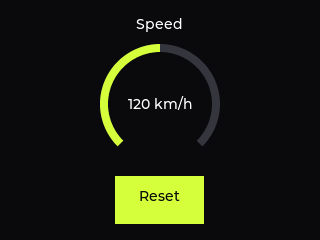
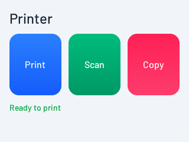
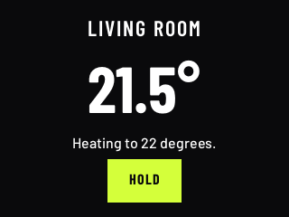

# lvgl26

[](https://github.com/filipsajdak/lvgl26/actions/workflows/ci.yml)
[](LICENSE)
[](https://github.com/filipsajdak/lvgl26/releases)

A C++26 framework over [LVGL](https://github.com/lvgl/lvgl) for embedded user interfaces. A screen is a tree that the compiler checks, and widgets follow typed state.

Public preview: GCC 16.2 or newer only.

One UI framework, from a low-cost microcontroller up. lvgl26 and LVGL are both MIT: no royalty per device, and no licence per developer seat.

<!-- snippet: examples/quick_start/main.cpp readme -->
```cpp
constinit lv::state speed{0 * km / h};

constexpr auto ui = lv::column(
  {
    .flex_align = {"center", "center", "center"},
    .size       = {320 * px, 240 * px},
  },
  lv::label({.text = "Speed"}),
  lv::arc(
    {
      .range = {0, 240},
      .size  = {120 * px, 120 * px},
      .value = lv::bind(speed),
    },
    lv::label({.align = "center", .text = lv::bind(speed)})
  ),
  lv::button({.on_clicked = [] { speed = 0 * km / h; }}, lv::label({.text = "Reset"}))
);
```



The dial and its label follow `speed`, and the button's lambda sets it. This is the [quick start](docs/quick-start.md): a test runs it and compares its picture with the one above, byte for byte.

## Why lvgl26

- **Mistakes are compile errors that say how to fix them.** A width without a unit, a misspelled LVGL value, an id that does not exist: each stops the build with a message. More than 340 [compile-fail tests](tests/fail) pin those messages.
- **No heap of its own.** The compiler builds the tree and sizes what it keeps. Styles, looks and constant texts stay in read-only memory. What needs memory at run time takes it from LVGL's heap, measured every night on a Cortex-M4 ([Targets](docs/targets.md)).
- **Made for AI agents as much as for people.** A [Claude Code skill](skills/write-ui/SKILL.md) tells an agent how to write a screen. A program can serve its screen to an agent over MCP: a [tree dump, screenshots and patches by id](examples/agent/mcp_host.cpp).

Compile time is measured per feature, every night: [the compile cost](docs/research/compile-time.md).

## State and bindings

A state holds a typed value of the application. Widgets follow it, and so do values computed from it.

<!-- snippet: examples/state/main.cpp tree -->
```cpp
constexpr auto ui = lv::column(
  {
    .flex_align = {"center", "center", "center"},
    .size       = {320 * px, 240 * px},
  },
  lv::dropdown({.options = lv::options_of<drink>, .selected = lv::bind(chosen), .width = 140 * px}),
  stepper<cups>(cups_text),
  lv::slider({.range = {1, 5}, .value = lv::bind(bold), .width = 200 * px}),  // follows, and writes back
  lv::label({.text = lv::bind(dose)}),                   // a quantity shows its unit: "18 g"
  lv::label({.text = lv::bind(needed, "{} g in all")}),  // a format shows the number only
  lv::label({.hidden = lv::bind(enough), .text = "Not enough beans"})
);
```

`chosen`, `cups` and `bold` are states. `dose`, `needed` and `enough` are `lv::computed` values made from them. The dropdown and the slider write the user's choice back. A state of a plain `int` stops the build, because the number does not say what it is.

[State and bindings](docs/state.md) has the rest.

## A list

A list holds rows of a struct, and shows a row template for each. A change touches the widgets of its own row only.

<!-- snippet: examples/lists/main.cpp model -->
```cpp
struct track_id {
  int value;
};

struct track {
  track_id id;  // names the row
  const char* title;
  lv::counter plays;
};

constinit lv::list<track, 8> tracks;               // room for eight rows
constinit lv::state current{track_id{0}};          // the selected row; no track has the id 0
```

`lv::each(tracks, &track::id, {.selected = lv::bind(current)}, track_row)` shows the rows. The list holds its rows inside itself, with room for eight. `tracks.update(row, [](track& t) { ++t.plays; })` sets the labels of that one row again.

[Lists](docs/lists.md) has the rest.

## A look from design tokens

An element names its look, and the token file says how it looks.

<!-- snippet: examples/looks/screen.hpp tree -->
```cpp
constexpr auto tile = []<action Action> {
  return lv::button(
    {.style = lv::look<"tile"> | lv::look_of<"tile", Action>},
    lv::label({.text = lv::like<Action, names>})
  );
};

constexpr auto ui = lv::group(
  {.style = lv::look<"page">},
  lv::label({.text = "Printer", .style = lv::look<"title">}),
  lv::group({.style = lv::look<"tiles">}, lv::for_each<action, lv::but<action::none>>(tile)),
  lv::label({.checked = true, .text = "Ready to print", .style = lv::look<"status">})
);
```



`lv::look<"tile">` builds a constant style from the group `tile` of [tokens.json](examples/looks/tokens.json). The compiler checks each entry against the style property of its name. The token file stays plain Design Tokens Format 2025.10, which design tools open.

[Looks](docs/looks.md) and [Design tokens](docs/tokens.md) have the rest.

## A task

A task is a coroutine on LVGL's loop. It waits for events, time and animations, in the order they happen.

<!-- snippet: examples/bounce/scene.hpp bounce -->
```cpp
inline lv::task<> bounce(lv::view<"obj"> box_view) {
  for (bool to_right = true;; to_right = !to_right) {
    lv::spawn(slide(box_view, to_right ? left : right, to_right ? right : left), box_view);
    co_await fall(box_view, drop_height);
    for (int height = next_height(drop_height); height > last_height; height = next_height(height)) {
      co_await rise(box_view, height);
      co_await fall(box_view, height);
    }
    co_await lv::sleep(rest);
    co_await rise(box_view, drop_height);  // picked up again
    co_await lv::sleep(held);
  }
}
```

A ball falls, bounces lower each time, rests and is picked up again. `lv::spawn(task, owner)` ties a task to a widget, and the task ends when the widget is deleted.

[Tasks](docs/tasks.md) and [Animation](docs/animation.md) have the rest.

## A design system: Signal

Signal comes with lvgl26: design tokens, themes and typefaces. Its theme styles every widget, so a screen needs no colour of its own.

<!-- snippet: examples/signal_type/main.cpp readme -->
```cpp
// A copy: a reference to the tokens would keep the token file in the program.
constexpr auto text = lv::signal::type_tokens.text;

constexpr auto title = lv::signal::type(text.title);            // 24 px, the space to the tilde
constexpr auto reading = lv::signal::numerals(text.numeral_l);  // 72 px, the sixteen characters of a reading

constexpr auto ui = lv::column(
  {
    .flex_align = {"center", "center", "center"},
    .size       = {320 * px, 240 * px},
    .style      = {.pad_gap = lv::signal::dark_tokens.space._2},
  },
  lv::label({.text = "LIVING ROOM", .style = lv::style({.text_font = title}) | text.title}),  // and its spacing
  lv::label({.text = "21.5°", .style = {.text_font = reading}}),
  lv::label({.text = "Heating to 22 degrees."}),
  lv::button(lv::label({.text = "HOLD"}))
);
```



The display takes the theme: `lv::display display{app, frame, lv::signal::dark_with_type};`. The compiler draws the two fonts from Signal's TrueType files into read-only memory.

[Themes](docs/themes.md) has the rest, and how to make a theme of your own.

## A project split into files

The printer port keeps each page in a file of its own. The shell declares them:

<!-- snippet: examples/ports/slint/printer/pages.hpp pages -->
```cpp
// The pages, each defined in its own file as lv::page_of<ui>: the shell shows them with
// lv::shown, and none of their trees is compiled in the shell.
extern const lv::page home_page;
extern const lv::page settings_page;
extern const lv::page ink_page;
extern const lv::page print_page;
extern const lv::page scan_page;
extern const lv::page copy_page;
extern const lv::page usb_page;
```

A page's file ends with `constinit const lv::page home_page = lv::page_of<ui>;`. The shell shows the page of a state with `lv::shown(active_page, lv::is<page::home>(home_page), ...)`. Every value has an arm, and nobody writes a size.

[Pages that follow a state](docs/mounting.md#pages-that-follow-a-state) and the [printer walkthrough](docs/port-slint-printer.md) have the rest.

## More

- [The documentation](docs/README.md): every feature has a page, from the tree and its widgets to fonts, images, input and settings.
- [What works today](https://filipsajdak.github.io/lvgl26/#features), and the [status page](https://filipsajdak.github.io/lvgl26/status.html) with what is planned.
- Coming from [Qt Quick](docs/from-qt.md), [Slint](docs/from-slint.md) or [TouchGFX](docs/from-touchgfx.md); the [examples](examples/README.md) hold the ports.

## Requirements

- GCC 16.2 or newer (`-std=c++26 -freflection`).
- CMake 3.30 or newer, and Ninja.
- No precompiled header that holds lvgl26's headers. With GCC 16.2 a precompiled header silently drops the precondition checks of templates ([GCC bug 128909](https://gcc.gnu.org/bugzilla/show_bug.cgi?id=128909)).

## Build and test

```sh
cmake --preset host-v96 && cmake --build --preset host-v96 && ctest --preset host-v96
```

`host-v96` builds against LVGL v9.6.0, and `host-v10` against the v10 development line (commit `53819fe4`). `-DFETCHCONTENT_SOURCE_DIR_LVGL=<path>` builds against a local checkout of LVGL.

## On a microcontroller

The library builds with `-fno-exceptions -fno-rtti`. A slice of it runs on an Arm Cortex-M4 in QEMU every night. [Targets](docs/targets.md) says how to build it, and what it costs.

## With Claude Code

The repository is also a Claude Code plugin. Its skill `write-ui` tells an agent which page to read for each feature, which header a name needs, and what to do with an error. Its research notes give an agent what is known about LVGL, C++26 and device UIs, with sources.

```text
/plugin marketplace add filipsajdak/lvgl26
/plugin install lvgl26@lvgl26
```

## In your editor

clangd cannot parse reflection, so lvgl26 gives it stub headers of the public API. Add `lvgl26_editor_support()` to your `CMakeLists.txt`, and your editor completes the members of `lv::arc({.` and marks a wrong name. [Editor support](docs/editor-support.md) says what works.

## Website

The site, <https://filipsajdak.github.io/lvgl26/>, is the plain HTML and CSS in `site/`, published on every push to `main`. `cd site && python3 -m http.server` previews it, and `python3 tools/check_site.py` checks every link. Update `site/status.html` with every feature.

## Licence

MIT, as is LVGL. [NOTICE.md](NOTICE.md) lists the borrowed parts and their licences.
