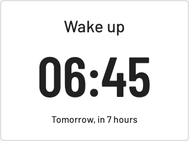

# Fonts

The compiler reads a TrueType file and makes the font. The device gets glyph pictures in read-only memory: no heap, no code that draws outlines, and no converter to run.

A font made by the compiler is in `#include <lv/font.hpp>`, and a font drawn on the device in `#include <lv/scaled_font.hpp>` (see [Which header](which-header.md)).



## Embed the files

<!-- snippet: examples/fonts/main.cpp files -->
```cpp
constexpr unsigned char barlow_ttf[] = {
#embed "fonts/Barlow-Medium.ttf"
};
constexpr unsigned char condensed_ttf[] = {
#embed "fonts/BarlowCondensed-SemiBold.ttf"
};
```

The file must have TrueType outlines: a `.ttf`. Its licence says whether its glyphs may go into a device; Barlow's does (SIL Open Font License).

## Say which file each family is

A font is part of the design, so its family, weight and size come from a typography token. A typeface says which file a family and weight is.

<!-- snippet: examples/fonts/main.cpp typeface -->
```cpp
constexpr char tokens_json[] = {
#embed "tokens.json"
  , 0
};
constexpr auto tok = lv::tokens<tokens_json>;

constexpr auto type = lv::typeface({
  {"Barlow", 500, barlow_ttf},
  {"Barlow Condensed", 600, condensed_ttf, "0123456789:"},  // only what a clock shows
});

constexpr auto label   = type(tok.text.label);
constexpr auto title   = type(tok.text.title);
constexpr auto numeral = type(tok.text.numeral);
```

- `type(token)` makes the font the token asks for. Keep it in a `constexpr` variable: the compiler draws it once.
- A file holds the characters from the space to the tilde. Name others, in UTF-8, as the fourth value. The clock digits above need eleven characters, not ninety-five.
- The same file, size and characters are one font in memory, however often you ask.

The tokens of this example are [examples/fonts/tokens.json](../examples/fonts/tokens.json).

## More than the default characters

A font holds the characters from the space to the tilde, and only what you name when you name any. A price with a euro sign, or a line with a middle dot, needs more than that, and naming them alone would leave out the letters. `lv::ascii_plus<"...">` is the default characters and the ones you add:

<!-- snippet: tests/font.cpp extra -->

- It goes where the characters go: the fourth value of a typeface entry, or `lv::font<ttf>(size, lv::ascii_plus<"€·">)`. The split form takes the same typeface.
- Each extra character costs what one of the 95 costs: about 0.75 G instructions of the compiler and about 120 bytes of flash at 16 px (measured with Barlow Medium). Two extra characters make a font 2.4 percent slower to build and 240 bytes larger.
- The first character outside the range turns the character map into a list: 2 bytes for each character of the font, about 200 bytes once, and LVGL finds a glyph by a search in the list and not by its place. Characters up to U+FFFF, 255 in all.
- `lv::latin1` is the default set and the accents of Latin-1 (U+00A0 to U+00FF), 191 characters, and `lv::latin1_plus<"€">` adds more: a text in French, German, Spanish, Italian or Portuguese. **It is the dear one**: 96 more glyphs than the default set cost about 86 G instructions of the compiler (a build of 11 seconds and 0.9 GB for one font at 16 px, against 64 G) and about 12 KB of flash for each font and size. Name the few accents that a text needs with `lv::ascii_plus<"éè">` when it needs a few.
- Latin-1 stops at U+00FF. Polish (ą ć ę ł ń ś ź ż), Czech, Turkish and the euro sign are outside it: name them with `lv::ascii_plus` or `lv::latin1_plus<"ąćęłńśźż€">`.
- A character the file lacks stops the build and names it. Text that is not UTF-8 stops it, and so do more than 255 characters.

## Use them

<!-- snippet: examples/fonts/main.cpp tree -->
```cpp
constexpr auto ui = lv::column(
  {.flex_align = {"center", "center", "center"}, .size = {320 * px, 240 * px}},
  lv::label({
    .text  = "Wake up",
    .style = {.text_font = title},
  }),
  lv::label({
    .text  = "06:45",
    .style = {.text_font = numeral},
  }),
  lv::label({
    .text  = "Tomorrow, in 7 hours",
    .style = {.text_font = label},
  })
);
```

## Fonts of a project in several files

`type(token)` draws the font in the file that writes it. A program of many files that asks for the same font in each pays for it in each. Draw each font once, in a file of its own, and name it everywhere else:

<!-- snippet: examples/fonts_split/main.cpp tree -->
```cpp
constexpr auto ui = lv::column(
  {.flex_align = {"center", "center", "center"}, .size = {320 * px, 240 * px}},
  lv::label({
    .text  = "Wake up",
    .style = {.text_font = lv::font_of<"text.title">},
  }),
  lv::label({
    .text  = "06:45",
    .style = {.text_font = lv::font_of<"text.numeral">},
  }),
  lv::label({
    .text  = "Tomorrow, in 7 hours",
    .style = {.text_font = lv::font_of<"text.label">},
  })
);
```

`lv::font_of<"text.title">` is the font of the typography token `text.title`. The name is checked against the token file where it is written, so a typo is a compile error that lists the names there. A file that names a font holds only its address, which is a constant whatever the font holds, so it draws nothing and costs next to nothing.

The font is drawn by one file for each font, `font_text_title.cpp` for this one. It embeds the TrueType file, says which file each family and weight is, and defines the object:

<!-- snippet: examples/fonts_split/font_text_label.cpp font -->
```cpp
#include "design.hpp"

namespace {

constexpr unsigned char barlow_ttf[] = {
#embed "fonts/Barlow-Medium.ttf"
};
constexpr auto type = lv::typeface({{"Barlow", 500, barlow_ttf}});

}  // namespace

template <>
const lv::drawn_font lv::font_object<"text.label"> = lv::draw<"text.label">(type);
```

- The design header (`design.hpp` in the example) names the token file and holds no font file: `lv::design_of<decltype(tok)>{.tokens = tok}`. Every file includes it.
- Name a font before you define it in the same file, never after: a file that defines a font and names it earlier stops with "specialization after instantiation".
- A font that is named and has no defining file stops the build, before the link, with the name of the file to add: `main.cpp:12: the font 'text.title' has no file that draws it. Add font_text_title.cpp with ...`. `LVGL26_CHECK_FONTS=OFF` turns the check off. A library that draws fonts for its users lists their tokens in the property `LVGL26_FONTS` of its target.
- Both forms live together. A one-file program and the quick start keep `type(token)`. Switch to the split form when a second file asks for a font that the first draws.
- The picture of the example is the one of the example above, pixel for pixel, and the program holds the same bytes: the section sizes of the linked programs are equal.

What it costs, on the same machine, as instructions of the compiler:

| File | In place (`examples/fonts`) | In files (`examples/fonts_split`) |
|---|---|---|
| The screen, three fonts | 164 G | 44 G |
| One file that draws a font (16 px, 28 px, a clock) | none | 65 G, 72 G, 26 G |

A file that names a font costs about 0.08 G more for each distinct name, for the check against the token file. The files that draw the fonts compile side by side.

## A font without a token

A font that no token names is an exception to the design, and the code says so:

```cpp
constexpr auto odd = lv::font<barlow_ttf>(18 * px);

lv::label({.text = "18 px, once", .style = {.text_font = lv::raw(odd)}})
```

Without `lv::raw` the build stops:

```text
error: static assertion failed: lv: wrong value for this property. It takes a font from a
typography token (`type(tok.text.title)` with an lv::typeface, see lv/font.hpp), or
lv::raw(font) for a font that no token names. You gave const _lv_font_t*.
```

## A size that changes while the program runs

A font made by the compiler has one size. Where the size is only known on the device, `lv::scaled_font` lets the device draw the glyphs. A style binds to it, as a property binds to a state:

<!-- snippet: examples/scaled_font/main.cpp font -->
```cpp
constinit lv::scaled_font reading{barlow_ttf, tok.text.label};  // the size of the token: 16 px

constexpr auto ui = lv::column(
  {.size = {320 * px, 240 * px}}, lv::label({
                                    .id    = "reading",
                                    .text  = "21.5",
                                    .style = {.text_font = lv::bind(reading)},
                                  })
);
```

<!-- snippet: examples/scaled_font/main.cpp resize -->
```cpp
  reading.resize(tok.text.title);    // 28 px: the label follows
  reading.resize(lv::raw(31 * px));  // a size that no token names
```

- Its size comes from a typography token too. A size that no token names is `lv::raw(...)`.
- It needs LVGL's TinyTTF, which is off by default. Turn it on before lvgl26 is added: `set(LVGL26_TTF ON)`.
- The device pays for it: the whole font file in flash, TinyTTF's code, and heap for the glyphs it has drawn.
- A theme cannot hold such a font, because a theme is a constant.

## What a font costs

Barlow Medium with its 95 characters, measured once on one machine:

| Size | Compile time | In flash |
|---|---|---|
| 14 px | about 3.5 s | about 5 KB |
| 24 px | about 4.5 s | about 10 KB |
| 48 px | about 7.5 s | about 32 KB |

- The font file itself does not reach the program.
- Kerning pairs add three bytes each. Barlow Medium at 32 px has 748 among these characters.
- The characters cost more compile time than the size does. A font of sixteen characters at 16 px takes about half a second.
- A large font costs memory in the compiler. Barlow Condensed with 95 characters at 208 px takes about 34 s and 5.4 GB.
- Make each font in one file, so that only that file pays the compile time: see "Fonts of a project in several files".

## Rules and limits

- Sizes are from 4 px to 255 px, and a font holds at most 255 characters.
- There is no hinting. Very small sizes are a little softer than a font made with LVGL's converter.
- Kerning is read from the file's `kern` feature (GPOS). Kerning that differs by script is not read.
- OpenType files with CFF outlines (`.otf`) are refused with a message.
- A character the file lacks stops the build and names the character.
- The compiler draws each glyph in a constant evaluation of its own, so a font needs no raised `-fconstexpr-ops-limit`, and lvgl26 sets none. The largest font measured, Barlow Medium with 95 characters at 255 px, needs at most 28 million operations of the 33.5 million GCC allows.
- The pixels of a font take at most 1 MB, the most LVGL's format can address. A larger font stops the build and says how many bytes it needs.
