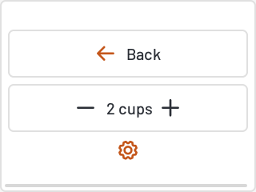

# Icons

An icon is a character of an icon font. lvgl26 knows the names of Phosphor's icons, checks each one where it is written, and draws a font of only the icons you name.

An icon is in `#include <lv/icons.hpp>`, and the file of its font in `#include <lv/icons_font.hpp>`, which only the file that draws the font includes. The font is made by `#include <lv/font.hpp>` (see [Which header](which-header.md)).



## The smallest example

<!-- snippet: examples/icons/main.cpp tree -->
```cpp
constexpr auto ui = lv::column(
  {.flex_align = {"center", "center", "center"}, .size = {320 * px, 240 * px}},
  lv::row(
    {.flex_align = {"center", "center", "center"}, .size = {300 * px, 60 * px}},
    lv::icon<"arrow-left">({.style = {.text_color = tok.color.accent, .text_font = icon_font}}),
    lv::label({.text = " Back", .style = {.text_color = tok.color.ink, .text_font = label_font}})
  ),
  lv::row(
    {.flex_align = {"center", "center", "center"}, .size = {300 * px, 60 * px}},
    lv::icon<"minus">({.style = {.text_color = tok.color.ink, .text_font = icon_font}}),
    lv::label(
      {.text = " 2 cups ", .style = {.text_color = tok.color.ink, .text_font = label_font}}
    ),
    lv::icon<"plus">({.style = {.text_color = tok.color.ink, .text_font = icon_font}})
  ),
  lv::icon<"gear">({.style = {.text_color = tok.color.accent, .text_font = icon_font}})
);
```

`lv::icon<"arrow-left">` is a label whose text is the icon. Its font and colour come from its style, as for any label.

## How it works

The font holds only the icons you name, as a font of any other characters does. The typeface says which file draws the icons and which icons the font holds:

<!-- snippet: examples/icons/main.cpp type -->
```cpp
constexpr char tokens_json[] = {
#embed "tokens.json"
  , 0
};
constexpr auto tok = lv::tokens<tokens_json>;

constexpr unsigned char barlow_ttf[] = {
#embed "fonts/Barlow-Medium.ttf"
};

constexpr auto type = lv::typeface({
  {"Barlow", 500, barlow_ttf},
  {"Phosphor",
   700,
   lv::icons::phosphor_bold_ttf,
   lv::glyphs<"arrow-left", "gear", "plus", "minus">},
});

constexpr auto label_font = type(tok.text.label);
constexpr auto icon_font  = type(tok.icon.md);
```

- `lv::icons::phosphor_bold_ttf`, from `<lv/icons_font.hpp>`, is the file of Phosphor Bold, which the library carries. It is under the MIT licence (`include/lv/icons/LICENSE-Phosphor.txt`).
- `lv::glyphs<"arrow-left", "gear">` is the list of characters for the typeface's fourth value. Four icons make a font of four glyphs.
- The size, the family and the weight of the icons are a typography token, `icon.md`: the token file decides how large the icons are, as it does for text.

## What you can do

- `lv::glyph<"gear">` is the text of one icon, for `.text` of a label: `lv::label({.text = lv::glyph<"gear">, .style = {.text_font = icon_font}})`.
- `lv::icon<"gear">({...})` takes the properties of a label and sets its text.
- An icon is text: `.text_color` tints it, and the size is the font's.

## What the compiler checks

A name that is no icon stops the build and offers the nearest names:

<!-- message: icon_unknown_name -->
```text
error: constexpr message: lv: there is no icon 'arow-left' in Phosphor. Did you mean 'arrow-left'? The nearest names: arrow-left, caret-left, align-left, copyleft, arrow-down.
```

## What it costs

- A file that names icons pays for the table once, about 0.3 G instructions, and about 0.02 G for each icon: eight icons add 0.5 G to a file that costs 9 G with nothing in it. The font file is a header of its own, because embedding it costs 1 G in each file that reads it.
- A font of a few icons draws in well under a second (24 px, four glyphs).
- On the device, nothing but the glyph pictures: the font file does not reach the program.

## Limits

- Phosphor's Bold weight only. Other weights and other icon sets are not built.
- An icon and words in one label need two labels in a row.
