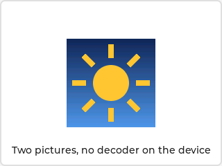

# Images

The compiler decodes a PNG file and stores its pixels in read-only memory, in the form the display draws fastest. The device needs no decoder and no heap.



## Embed a file and name its picture

<!-- snippet: examples/images/main.cpp files -->
```cpp
constexpr unsigned char sky_png[] = {
#embed "sky.png"
};
constexpr unsigned char sun_png[] = {
#embed "sun.png"
};

constexpr auto sky = lv::image_file<sky_png>;  // every pixel opaque: stored as the display's own pixels
constexpr auto sun = lv::image_file<sun_png>;  // see-through around the sun: stored with an alpha plane
```

`lv::image_file` is what an image widget takes as its `.src`:

<!-- snippet: examples/images/main.cpp tree -->
```cpp
constexpr auto ui = lv::box({.size = {320 * px, 240 * px}})[
    lv::image({.align = "center", .src = sky}),
    lv::image({.align = "center", .src = sun}),
    lv::label({.align = "bottom_mid", .text = "Two pictures, no decoder on the device"})];
```

## How a picture is stored

The compiler looks at the picture and at the display's colour depth, and chooses:

| The picture | 16-bit display | 32-bit display |
|---|---|---|
| Every pixel opaque | RGB565: two bytes for each pixel | XRGB8888: four bytes |
| Some pixels see-through | RGB565 and a byte of alpha: three bytes | ARGB8888: four bytes |

- An opaque picture in the display's own format is drawn by copying rows.
- Nothing is compressed. LVGL's compressed forms need the whole picture on the heap to draw it.

## What a picture costs

Measured once on one machine, as the work of the compiler:

| Picture | Compile time | In flash, 16-bit display |
|---|---|---|
| 32 x 32, see-through | about 0.1 s | 3 KB |
| 128 x 128, see-through | about 1.4 s | 48 KB |
| 128 x 128, opaque | about 1.3 s | 32 KB |

## The size limit

A picture is at most 128 x 128 pixels, because a large one makes the build slow. A whole 320 x 240 screen costs seven to fourteen seconds. A larger file stops the build:

```text
error: lv: this picture is 200 x 100 pixels, and the compiler decodes at most 16384 (a large
picture makes the build slow). To allow it, raise lv::config::compile_time_image_pixels.
```

The limit is a project setting:

```cpp
template <>
inline constexpr lv::config lv::cfg<lv::override>{.compile_time_image_pixels = 320 * 240};
```

## Rules and limits

- The file is a PNG with 8 bits for each channel: grey, RGB or a palette, with or without alpha. Interlaced and 16-bit files are refused with a message.
- The picture keeps its size: see-through borders are not cut off.
- Photos and whole-screen backgrounds are better kept as JPEG and decoded on the device. That form is not built yet.
- A very large picture may not link on macOS, whose linker limits the length of a name. 128 x 128 links.
