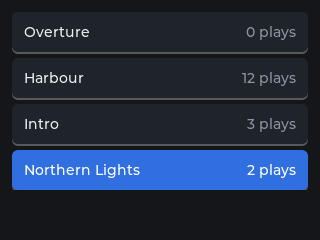

# Lists

A list shows a row template once for each row of an `lv::list`. When the program adds, removes, moves or changes a row, only the widgets of that row change. The other rows keep their widgets, their animations, their tasks and the focus.

`lv::list` and `lv::each` are in their own header: `#include <lv/list.hpp>` (see [Which header](which-header.md)).



## The rows

An `lv::list<T, N>` holds up to N rows of type T. N is fixed at compile time, so the list never grows on the heap. Make it a `constinit` global, as a state is. A row needs a key: a named value that tells it apart from the others.

<!-- snippet: examples/lists/main.cpp model -->
```cpp
struct track_id {
  int value;
};

struct track {
  track_id id;  // names the row
  const char* title;
  lv::counter plays;
};

constinit lv::list<track, 8> tracks;               // room for eight rows
constinit lv::state current{track_id{0}};          // the selected row; no track has the id 0
```

A key is like the value of a state: a struct with one integer member, or an enum. A plain `int` key is refused, as a plain `int` state is.

## The row template

A row template is a tree like any other. `lv::bind(&track::title)` makes a property follow a field of the row. A text field is shown as it is, without a copy: the list keeps each row at one address until the row goes. A number field needs a format, as a state does.

<!-- snippet: examples/lists/main.cpp row -->
```cpp
// One row: a button that is checked while it is the selected one. state_trickle hands that
// state to the labels, which style themselves for it.
constexpr auto track_row =
    lv::button({.flex_flow = "row", .size = {100 * pct, lv::size_content}, .state_trickle = true,
                .style = {.bg_color = tok.color.row, .pad_all = tok.space.edge, .radius = tok.radius.row},
                .style_checked = {.bg_color = tok.color.selected}})[
        lv::label({.flex_grow = 1, .style = {.text_color = tok.color.text},
                   .style_checked = {.text_color = tok.color.on_selected}, .text = lv::bind(&track::title)}),
        lv::label({.style = {.text_color = tok.color.quiet}, .style_checked = {.text_color = tok.color.on_selected},
                   .text = lv::bind(&track::plays, "{} plays")})];
```

Every style of a node works in a row template, and all rows share it from read-only memory. Rows may differ in size: the layout gives each its own.

## The list in a tree

`lv::each(tracks, &track::id)[track_row]` puts the rows into the widget that holds it. In a column they run from top to bottom, in a row from left to right: `lv::column`, `lv::row`, or a group with a `.flex_flow`. That widget may have other children before and after the rows, but only one `lv::each`.

<!-- snippet: examples/lists/main.cpp tree -->
```cpp
constinit lv::computed has_tracks{[](lv::counter n) { return n.value > 0; }, tracks.count()};

// Groups: boxes without the theme's look, laid out as columns.
constexpr auto ui = lv::group({.flex_flow = "column", .size = {320 * px, 240 * px},
                               .style = {.bg_color = tok.color.screen, .bg_opa = tok.opacity.opaque,
                                         .pad_all = tok.space.edge, .pad_gap = tok.space.gap}})[
    lv::label({.hidden = lv::bind(has_tracks), .style = {.text_color = tok.color.quiet}, .text = "No tracks"}),
    lv::group({.flex_flow = "column", .size = {100 * pct, lv::size_content}, .style = {.pad_gap = tok.space.gap}})[
        lv::each(tracks, &track::id, {.selected = lv::bind(current)})[track_row]]];
```

`tracks.count()` is the number of rows as an `lv::state<lv::counter>`. Here a computed of it hides the "No tracks" label.

## Changing the rows

<!-- snippet: examples/lists/main.cpp changes -->
```cpp
void play(std::size_t row) {
  tracks.update(row, [](track& t) { ++t.plays; });  // that row's labels are set again
}
```

| Call | What the views do |
|---|---|
| `insert(i, row)`, `push_back(row)` | Build the widgets of the new row, at its place |
| `erase(i)` | Delete the widgets of that row |
| `move(from, to)` | Move the widgets of that row |
| `update(i, f)` | Set the bound properties of that row again. A new key makes a new row |
| `assign(rows)` | Keep the widgets of every key they find again, and move them into place |
| `clear()` | Delete all rows |

`insert()`, `push_back()` and `assign()` return `std::expected`. `lv::list_error::full` says the list holds as many rows as it can; then nothing changed. `lv::list_error::out_of_memory` says LVGL had no memory for a row's widgets. An index out of range is a bug, and breaks a contract.

## The selected row

`.selected = lv::bind(current)` makes a state of the key's type follow the selected row. A click on a row selects it, and so does the focus. A row that is a button joins the default group, so the keys move the selection. Setting the state from code selects too.

A row that goes leaves the selection as it was, even when it had the focus. Keys move the focus in the order the rows were built, which an insert or a move does not change yet.

The selected row gets LVGL's `checked` state, so `.style_checked` styles it. `.state_trickle = true` hands the state on to the children of a node.

A row's own field can give it that state too: `.checked = lv::bind(&job::printing)`. Then one row template has two looks.

## Work that belongs to a row

`.on_row = &start` is called with each row that is built, and its value. A task that it starts with `lv::spawn(work, row)` ends when the row goes. The widgets of a row are found by the ids of its template: `lv::row_view<track_row>{row}.get<"title">()`. They need no memory: the template says where they are.

## Mistakes the compiler catches

- A key that is a plain `int`, or a member of another type than the list's rows.
- Two row templates in one `lv::each`, or none.
- Two `lv::each` in one widget.
- `lv::bind(&track::title)` outside a row template, or on a property that takes several values.
- A field the property cannot show, a `std::string_view` field, or a member function.
- A `.selected` state of another type than the key.
- An id that the row template does not have, in `lv::row_view<...>::get`.

## Not yet

- A list that recycles its rows while it scrolls, over a count and a function that gives row i.
- Views that sort or filter a list without copying a row.
- `lv::each(&playlist::tracks, ...)` inside a component: that needs `lv::use`.
