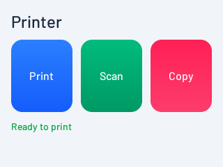

# Looks

A look is a named group of the project's design tokens, used as a style: `.style = lv::look<"tile">`. The code says what an element is, and the token file says how it looks.

The compiler finds the group in the token file, matches each entry to the style property of the same name, and builds a constant style in flash. A look costs no run time and no heap from lvgl26: LVGL keeps a pointer to the constant, as it does for every style of lvgl26.



## Name the token file once

A project names its token file once, before the first look, as it sets `lv::cfg`. The file with the specialization is included by every file of the project.

<!-- snippet: examples/looks/screen.hpp registration -->
```cpp
constexpr char tokens_json[] = {
#embed "tokens.json"
    , 0};
constexpr unsigned char barlow[] = {
#embed "fonts/Barlow-Medium.ttf"
};
constexpr auto tok = lv::tokens<tokens_json>;
```

<!-- snippet: examples/looks/screen.hpp design -->
```cpp
template <>
inline constexpr lv::design_of<decltype(looks::tok)> lv::design<lv::override>{
    .tokens = looks::tok, .type = lv::typeface({{"Barlow", 500, looks::barlow}})};
```

`lv::design_of` holds the tokens and the typeface that draws the fonts of the typography tokens. A project whose looks have no typography token leaves the typeface out: `{.tokens = tok}`. A registration that comes after the first look is a compile error, as it is for `lv::cfg`.

## Write what each element is

<!-- snippet: examples/looks/screen.hpp tree -->
```cpp
constexpr auto tile = []<action Action> {
  return lv::button({.style = lv::look<"tile"> | lv::look_of<"tile", Action>})[
      lv::label({.text = lv::like<Action, names>})];
};

constexpr auto ui = lv::group({.style = lv::look<"page">})[
    lv::label({.style = lv::look<"title">, .text = "Printer"}),
    lv::group({.style = lv::look<"tiles">})[lv::for_each<action, lv::but<action::none>>(tile)],
    lv::label({.checked = true, .style = lv::look<"status">, .text = "Ready to print"})];
```

A look is a style value. It goes wherever a style goes: in a node, in a theme, in a part that takes an `lv::style_value`, and on either side of `|` with `lv::on(...)`, another style or a composite token. It is resolved when it is first used, and a file that names no look does not pay for any.

The token file holds one group for each look. Its entries are named for the style properties they set.

<!-- snippet: examples/looks/tokens.json -->
```json
{
 "$schema": "https://www.designtokens.org/schemas/2025.10/format.json",
 "$description": "The design of the looks example: values first, then one group for each look. A group's entries are named for the style properties they set.",
 "font": {
  "text": {
   "$type": "fontFamily",
   "$value": "Barlow"
  }
 },
 "text": {
  "$type": "typography",
  "body": {
   "$value": {
    "fontFamily": "{font.text}",
    "fontSize": {"value": 14, "unit": "px"},
    "fontWeight": 500,
    "lineHeight": 1.2,
    "letterSpacing": {"value": 0, "unit": "px"}
   }
  },
  "label": {
   "$value": {
    "fontFamily": "{font.text}",
    "fontSize": {"value": 16, "unit": "px"},
    "fontWeight": 500,
    "lineHeight": 1.2,
    "letterSpacing": {"value": 0, "unit": "px"}
   }
  },
  "title": {
   "$value": {
    "fontFamily": "{font.text}",
    "fontSize": {"value": 24, "unit": "px"},
    "fontWeight": 500,
    "lineHeight": 1.2,
    "letterSpacing": {"value": 0, "unit": "px"}
   }
  }
 },
 "color": {
  "$type": "color",
  "paper": {
   "$value": {"colorSpace": "srgb", "components": [0.9451, 0.9608, 0.9765], "hex": "#f1f5f9"}
  },
  "ink": {
   "$value": {"colorSpace": "srgb", "components": [0.1137, 0.1608, 0.2392], "hex": "#1d293d"}
  },
  "gray": {
   "$value": {"colorSpace": "srgb", "components": [0.3843, 0.4549, 0.5569], "hex": "#62748e"}
  },
  "white": {
   "$value": {"colorSpace": "srgb", "components": [1, 1, 1], "hex": "#ffffff"}
  },
  "green": {
   "$value": {"colorSpace": "srgb", "components": [0, 0.651, 0.2431], "hex": "#00a63e"}
  },
  "blue": {
   "$value": {"colorSpace": "srgb", "components": [0.1686, 0.498, 1], "hex": "#2b7fff"}
  },
  "blue_deep": {
   "$value": {"colorSpace": "srgb", "components": [0.0824, 0.3647, 0.9882], "hex": "#155dfc"}
  },
  "teal": {
   "$value": {"colorSpace": "srgb", "components": [0, 0.7373, 0.4902], "hex": "#00bc7d"}
  },
  "teal_deep": {
   "$value": {"colorSpace": "srgb", "components": [0, 0.6, 0.4], "hex": "#009966"}
  },
  "red": {
   "$value": {"colorSpace": "srgb", "components": [1, 0.1255, 0.3373], "hex": "#ff2056"}
  },
  "red_deep": {
   "$value": {"colorSpace": "srgb", "components": [0.9922, 0.2392, 0.4275], "hex": "#fd3d6d"}
  },
  "ink_pressed": {
   "$value": {"colorSpace": "srgb", "components": [0.1922, 0.2549, 0.3451], "hex": "#314158"}
  }
 },
 "space": {
  "$type": "dimension",
  "page": {
   "$value": {"value": 16, "unit": "px"}
  },
  "gap": {
   "$value": {"value": 12, "unit": "px"}
  }
 },
 "page": {
  "bg_color": {
   "$value": "{color.paper}"
  },
  "bg_opa": {
   "$type": "number",
   "$value": 1
  },
  "pad_all": {
   "$value": "{space.page}"
  },
  "pad_row": {
   "$value": "{space.gap}"
  },
  "text_color": {
   "$value": "{color.ink}"
  },
  "text_font": {
   "$value": "{text.body}"
  },
  "$extensions": {
   "io.github.filipsajdak.lvgl26": {
    "layout": "flex",
    "flex_flow": "column"
   }
  }
 },
 "title": {
  "text_font": {
   "$value": "{text.title}"
  }
 },
 "tiles": {
  "pad_column": {
   "$value": "{space.gap}"
  },
  "width": {
   "$type": "dimension",
   "$value": {"value": 288, "unit": "px"}
  },
  "height": {
   "$type": "dimension",
   "$value": {"value": 104, "unit": "px"}
  },
  "$extensions": {
   "io.github.filipsajdak.lvgl26": {
    "layout": "flex",
    "flex_flow": "row"
   }
  }
 },
 "tile": {
  "width": {
   "$type": "dimension",
   "$value": {"value": 88, "unit": "px"}
  },
  "height": {
   "$type": "dimension",
   "$value": {"value": 104, "unit": "px"}
  },
  "radius": {
   "$type": "dimension",
   "$value": {"value": 16, "unit": "px"}
  },
  "bg_opa": {
   "$type": "number",
   "$value": 1
  },
  "shadow_width": {
   "$type": "dimension",
   "$value": {"value": 0, "unit": "px"}
  },
  "text_color": {
   "$value": "{color.white}"
  },
  "text_font": {
   "$value": "{text.label}"
  },
  "pressed": {
   "bg_opa": {
    "$type": "number",
    "$value": 0.8
   }
  },
  "$extensions": {
   "io.github.filipsajdak.lvgl26": {
    "bg_grad_dir": "ver",
    "layout": "flex",
    "flex_flow": "column",
    "flex_main_place": "center",
    "flex_cross_place": "center",
    "flex_track_place": "center"
   }
  }
 },
 "status": {
  "text_color": {
   "$value": "{color.gray}"
  },
  "checked": {
   "text_color": {
    "$value": "{color.green}"
   }
  }
 },
 "tile-print": {
  "bg_color": {
   "$value": "{color.blue}"
  },
  "bg_grad_color": {
   "$value": "{color.blue_deep}"
  }
 },
 "tile-scan": {
  "bg_color": {
   "$value": "{color.teal}"
  },
  "bg_grad_color": {
   "$value": "{color.teal_deep}"
  }
 },
 "tile-copy": {
  "bg_color": {
   "$value": "{color.red}"
  },
  "bg_grad_color": {
   "$value": "{color.red_deep}"
  }
 }
}
```

## What an entry may be

The token file is a plain Design Tokens file (Format 2025.10): a design tool opens it and finds nothing of ours that it cannot read. An entry is matched to the style property that has its name, and its token type is checked against what the property takes.

| Token type | Style properties | Example entry |
|---|---|---|
| `color` | A color: `bg_color`, `text_color`, `border_color` | `"bg_color": {"$value": "{color.paper}"}` |
| `color` written `#rrggbbaa` | The color, and the opacity of the same name | `"bg_color": {"$type": "color", "$value": "#2b7fff80"}` sets `bg_color` and `bg_opa` |
| `dimension` | A length: `radius`, `width`, `pad_row`, `border_width` | `"radius": {"$type": "dimension", "$value": "16px"}` |
| `number`, 0 to 1 | An opacity: `bg_opa`, `text_opa` | `"bg_opa": {"$type": "number", "$value": 1}` |
| `number`, whole | A whole number: `arc_rotation` | `"flex_grow": {"$type": "number", "$value": 1}` |
| `duration` | A time: `anim_duration` | `"anim_duration": {"$type": "duration", "$value": "200ms"}` |
| `typography` on `text_font` | A font, drawn by the compiler through the typeface | `"text_font": {"$value": "{text.label}"}` |
| `shadow`, `border`, `transition` | Merged as `style \| token` is, under any name | `"elevation": {"$value": "{elevation.card}"}` |

A color with an alpha sets the opacity property of its color (`bg_color` with `bg_opa`, `text_color` with `text_opa`, `image_recolor` with `image_recolor_opa`). Only a color that carries an alpha does it: an opaque color sets no opacity, and an `bg_opa` entry in the same group wins. Colors written as objects (`colorSpace`, `components`, `alpha`) are not read for alpha yet.

A shorthand such as `pad_all`, `pad_gap` or `margin_hor` is kept as the properties it stands for, so that the style is a constant and a state can override one of them. A JSON object has no order, so the order of the entries does not matter: an entry the group names itself (`pad_top`) beats a shorthand that covers it, and a narrower shorthand (`pad_hor`) beats a wider one (`pad_all`). This is the one rule of every style: a theme, `lv::on` and a node's `.style` follow it too (see [Themes](themes.md)). `size` takes two values, and a token holds one: write `width` and `height`.

### What the standard has no type for

An LVGL value by name (`flex_flow`, `text_align`, `layout`) and a size in percent are not Design Tokens types. They go in the `$extensions` of the group, under a key in reverse domain notation, as the format recommends (5.2.3), and a design tool keeps them without reading them:

```json
"tiles": {
  "pad_column": {"$type": "dimension", "$value": "12px"},
  "width": {"$type": "dimension", "$value": "288px"},
  "$extensions": {
    "io.github.filipsajdak.lvgl26": {"layout": "flex", "flex_flow": "row", "width": "100%"}
  }
}
```

The `$value` of `width` is what a design tool shows, and what a tree without lvgl26 would use: the percentage in `$extensions` wins in a look. The key is one named constant (`vendor_key` in `include/lv/tokens.hpp`). An unknown name or value there is a compile error that lists what is valid. A percentage is accepted for `width`, `height`, `min_*`, `max_*`, `x`, `y`, `transform_width`, `transform_height`, `translate_x` and `translate_y`, the properties for which LVGL takes one. A string token (`"$type": "string"`) is no standard type for a style property and is a compile error that points here. A percentage as a dimension `$value` is one too. For percentages in the standard, see the research note `docs/research/dtcg.md`.

## Parts and states are layers

A group nested in a look is a layer, and nothing else: its name is an LVGL state (`checked`, `pressed`, `focused`, `disabled`) or part (`knob`, `indicator`, `items`, `selected`). It is the same constant style that `lv::on("knob", "pressed", {...})` makes. A state inside a part is both: `knob.pressed` is the pressed state of the knob. A layer may have its own `$extensions`. A group named `main` or `default` adds no part and no state: its entries are those of the group it is in, and win over the entries beside it.

```json
"gauge": {
  "bg_color": {"$value": "{color.gray}"},
  "indicator": {"bg_color": {"$value": "{color.blue}"}},
  "knob": {"bg_color": {"$value": "{color.white}"}, "pressed": {"bg_color": {"$value": "{color.red}"}}}
}
```

Any other nested group is a compile error, with a "did you mean" for a name close to a part or state: `cheked` inside `status` says `Did you mean 'checked'?` and lists the parts and the states. A name that is a part or a state is always a layer, so no variant can be mistaken for one.

## Variants

The four tiles share a frame and differ in color. A variant is a sibling group, `tile-print` beside `tile`, because a group that extends or nests in its own parent is circular in the standard, and a group name cannot hold a dot. Several looks in one string stack, and a later one wins:

```cpp
lv::button({.style = lv::look<"tile tile-print">})
```

`lv::look<"tile"> | lv::look<"tile-print">` means the same. The string form is shorter, and it names each look in one place. In a part that `lv::for_each` repeats, `lv::look_of<"tile", Action>` is the look named for the enumerator: `tile-print` for `action::print`. A name that the token file lacks is a compile error that lists the groups, with the one it was probably meant to be (`tile_print`: the compiler spells a dash as an underscore). A group is written `lv::look<"queue.card">` when it is in another group that only organizes: `queue` has no entries, and `card` is the look.

`"$extends"`, which the standard has for a variant that inherits its base (`"tile-print": {"$extends": "{tile}", ...}`), is not read yet. A look of a group that has it is a compile error that says so.

## Size and layout

A look may carry fixed sizes, padding, gaps, alignment and flex settings: LVGL keeps all of them as style properties. Positions that depend on other sizes stay in the tree: a token file cannot compute. For percentages, see the research note `docs/research/less-boilerplate.md`.

When a node and a look both say something, these rules decide:

- The node's own properties beat a look. LVGL's local styles beat an added style, and `.size`, `.flex_flow` and `.style_checked` are local. `lv::group({.size = {30 * px, 20 * px}, .style = lv::look<"tile">})` is 30 by 20.
- What a factory starts a widget with gives way to everything else. `lv::group` fills its parent, and `lv::row` and `lv::column` are flex containers, through one constant style at the bottom of the widget's styles, as a browser's default style sits under a page's own. The node's own properties, its looks, a state layer of a look and a style added later beat it; a theme does not, since a theme is applied before it. A look with a `width` leaves the height to fill, and a look that sets the flow keeps the flex layout.
- A shorthand in a look does not beat a layer of the same look: both are constant styles, added in order.

Text style reaches a label by LVGL's own inheritance, from the look of its parent. The tile's `text_color` and `text_font` reach its label, so the label needs no look of its own. `text_color`, `text_opa`, `text_font`, `text_align`, letter and line spacing and `text_decor` are inherited; `image_recolor` is not, so an icon in a button needs a look of its own. A label that differs from its parent has a look of its own: `lv::look<"status">`.

## A part library with several designs

A part that several designs share takes the design as a template parameter and passes it on:

```cpp
template <class Design = lv::override>
constexpr auto chip = lv::box({.style = lv::look<"chip", Design>});
```

`chip<>` uses the design the project registered. `chip<dark>` uses a design registered for the tag `dark`: `lv::design<dark>`, specialized in the same way as `lv::design<lv::override>`.

## What a look costs

Nothing, where none is named. A file that includes `<lv/lv.hpp>` compiles in the same number of instructions with and without `lv/look.hpp`, and `tests/large_tree.cpp` is not dearer. A look is worked out when it is first used, once for each path and design.

| Measured, in instructions of the compiler | Cost |
|---|---|
| A look of five plain entries | about 0.6 G |
| One more layer, such as `pressed` | about 0.25 G |
| One more enumerator entry, such as `flex_flow` | about 0.2 G |
| One more look that asks for a font already drawn | about 0.45 G: the font is drawn once for each file of the typeface and size, however many looks ask |
| One more look with a font of its own size | the drawing itself, about 45 G, and about 7 G more than the same font written in the tree |
| 1, 10 and 50 looks of nine entries, one layer and a font, each in one box | 153.0 G, 155.8 G and 169.6 G |
| The same boxes with the styles written out | 146.8 G, 173.1 G and 289.9 G |

At run time a look is the constant `lv_style_t` and the property array that a written-out style makes. A box with two looks takes the same LVGL heap as a plain box, and a look with three layers takes 40 bytes more: LVGL's list of the styles of the widget. Built with optimization, no object of `lv::look` is left in the program. The cost of a font is its drawing: a project that names few sizes pays for few.

## Mistakes

Each one is a compile error with a message that says what is valid.

| Mistake | The message says |
|---|---|
| `lv::look<"queue.crad">` | There is no group `crad` in `queue`; the groups there; did you mean `card` |
| `lv::look<"tile.radius">` | `tile.radius` is a token, not a group |
| `lv::look<"">` | The look names no look; the groups of the token file |
| A group `cheked` nested in `status` | It is neither a part nor a state; did you mean `checked`; the parts and states; a variant is a sibling group |
| An entry `colour` | It fits no style property; the nearest ones |
| `radius` as a color | The entry is a color, the property takes a dimension |
| `"$type": "string"` for `flex_flow` | A string is no standard value; an LVGL value goes in `$extensions` |
| `"$value": "50%"` as a dimension | The standard has no percentage; use pixels for the value and `$extensions` for the percentage |
| `"flex_flow": "colum"` in `$extensions` | LVGL has no such value; its values |
| `"pad_all": "50%"` in `$extensions` | LVGL takes a percentage for width, height and the others only |
| A group with `$extends` | `$extends` is in the standard and not read yet |
| No registration | Name the token file once, before the first look |

In an editor, Clang marks a look that names no group of the token file where it is written ([editor support](editor-support.md)). It does not check the entries against the style properties: GCC does that.

## Find the looks that nothing uses

A token file grows, and a group that no element names is dead weight. `tools/look_groups.py` lists the component groups of a token file that no source names in an `lv::look`:

```sh
python3 tools/look_groups.py tokens.json src/
```

A component group is a group with an entry named for a style property, or with vendor data under `$extensions`, itself or in one of its layers (a look that sets something only when `checked` is one). Groups of values (`color`, `space`, `text`) have none, and are never listed. A group named like a state or a part belongs to the look above it; with no look above it, it is a look of its own. `lv::look_of<"tile", E>` uses every sibling group named `tile-...`, since the compiler picks one by the name of an enumerator. A look in a comment or inside another string uses nothing. Names are compared as the compiler reads them, so `lv::look<"tile_print">` uses `tile-print`. A group that another program uses is passed with `--ignore`. The test `look_groups_example` runs it on this example, and a misspelled `status.cheked` is listed, because no look reaches it.

## The same screen, written out

`examples/looks/before.hpp` is the screen above with every design value named in the tree. Both draw the same pixels: the test `looks_example` compares them.

<!-- snippet: examples/looks/before.hpp before -->
```cpp
constexpr lv::typeface type({{"Barlow", 500, barlow}});

constexpr auto tile(const char* text, const auto& tint) {
  const auto& t = tok.tile;
  return lv::button({.flex_align = {"center", "center", "center"},
                     .flex_flow = "column",
                     .style = {.bg_color = tint.bg_color,
                               .bg_grad_color = tint.bg_grad_color,
                               .bg_grad_dir = "ver",
                               .bg_opa = t.bg_opa,
                               .height = t.height,
                               .radius = t.radius,
                               .shadow_width = t.shadow_width,
                               .text_color = t.text_color,
                               .text_font = type(t.text_font),
                               .width = t.width},
                     .style_pressed = {.bg_opa = t.pressed.bg_opa}})[lv::label({.text = text})];
}

constexpr auto ui = lv::group({.flex_flow = "column",
                               .style = {.bg_color = tok.page.bg_color,
                                         .bg_opa = tok.page.bg_opa,
                                         .pad_all = tok.page.pad_all,
                                         .pad_row = tok.page.pad_row,
                                         .text_color = tok.page.text_color,
                                         .text_font = type(tok.page.text_font)}})[
    lv::label({.style = {.text_font = type(tok.title.text_font)}, .text = "Printer"}),
    lv::group({.flex_flow = "row",
               .style = {.height = tok.tiles.height, .pad_column = tok.tiles.pad_column, .width = tok.tiles.width}})[
        tile(names::print, tok.tile_print), tile(names::scan, tok.tile_scan), tile(names::copy, tok.tile_copy)],
    lv::label({.checked = true,
               .style = {.text_color = tok.status.text_color},
               .style_checked = {.text_color = tok.status.checked.text_color},
               .text = "Ready to print"})];
```

The words of the code, counted as `tools/code_words.py` counts them (an identifier, a number or a string; no punctuation, no comments):

| | Written out | With looks |
|---|---|---|
| Code that says how the screen looks | <!-- words: examples/looks/before.hpp before 162 -->162 | <!-- words: examples/looks/screen.hpp design 22 -->22 for the registration, once for the project, and <!-- words: examples/looks/screen.hpp tree 64 -->64 for the tree |
| Token entries | 36 | 36 |

The words moved. In this example the token file is the same in both columns: the entries are named for style properties either way, and the written-out code reads them one by one. A project that keeps only semantic tokens today (`color.print`, `space.gap`) has to write the component entries the looks need, and then the token file grows by about what the code loses. For the printer port of the research note `docs/research/less-boilerplate.md`, the code loses about 900 words and the token file gains about 600. A look pays off where one group is used again: the tile look serves three tiles here, and the spin box look of that port serves two pages.
