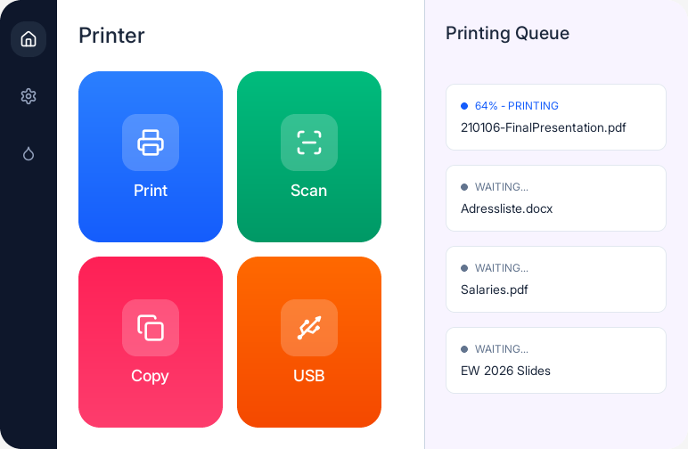
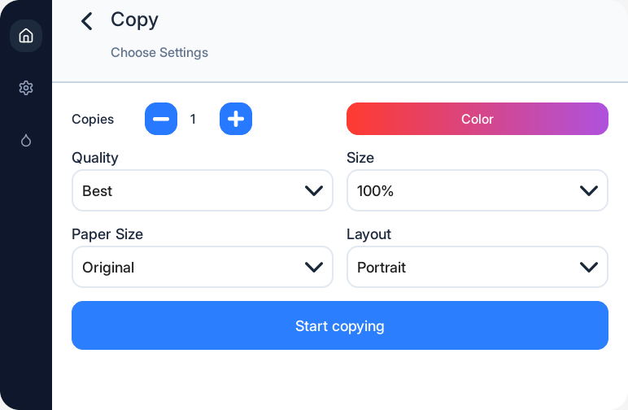

# Port walkthrough: the Slint printer panel

A touch panel for a printer, ported from a Slint demo to lvgl26 with the same screens and the same behaviour.
This page shows the result, how the port is organised, what differs from the original, and which choices were made.





## What the original is

The original is the printer demo in `demos/printerdemo` of the Slint repository.
This page follows [commit f3c4537](https://github.com/slint-ui/slint/tree/f3c4537/demos/printerdemo) of 2026-11-15.
It is MIT licensed, Copyright © SixtyFPS GmbH <info@slint.dev>, and the design is by Matthias Grimme.
[NOTICE.md](../examples/ports/slint/printer/NOTICE.md) lists what the port takes from it.
The short Slint excerpts below are quoted from that commit under the same licence.

The demo is one window of 772 x 504 pixels.
It has 21 `.slint` files with 2175 lines, and four themes that a menu in the side bar switches.
A side bar leads to three pages: home, settings and ink levels.
The home page has four actions and the print queue.
Print, Scan, Copy and USB are sub-pages that open over the home page.
The original keeps all four in the home page and moves each off screen with its `x` property.
Only the Print page animates that move, so the other three appear at once.

The port has the same screens and the same behaviour.
It is about 1300 lines of C++, with its screenshot tool and window, and a token file of about 470 lines.
The test `ports_printer` shows every page on each push and compares it with a reference picture.
The two pictures above are written by the test `ports_printer_shot`, which runs the port's own screenshot tool.
On LVGL v9.6.0, the tests `ports_printer_picture_home` and `ports_printer_picture_copy` fail when a picture here differs from what the port draws.

## Build and run

```sh
cmake --preset host-v96 && cmake --build --preset host-v96 --target printer_shot
build/host-v96/examples/ports/slint/printer/printer_shot <directory>
```

`printer_shot` needs no display.
It writes one PNG file for each page.
A window needs SDL2: the [README of the port](../examples/ports/slint/printer/README.md) says how to build it.

## How the port is organised

| In the Slint demo | In the port |
|---|---|
| `MainWindow` in `printerdemo.slint` | `shell.cpp`: the window, the side bar and the places where pages show |
| One component for each page in `pages/` | One file for each page: `home_page.cpp`, `copy.cpp`, `ink_page.cpp` and the others |
| Components in `components/`, such as `SpinBox` | `parts.hpp`: C++ functions that return a piece of tree |
| `DemoPalette` and `ComponentTheme` in `common.slint` | `tokens.json` |
| The global `PrinterState` | `state.hpp` |
| `if page == ...` in the window | `lv::shown` in `shell.cpp` |
| The global `PrinterQueue` | `queue.cpp` and `queue_column.hpp` |

### Tokens

The colors, sizes and times of the original sit in `DemoPalette` and `ComponentTheme`.
In the port they are `tokens.json`, a W3C Design Tokens file of about 90 tokens.
It holds colors, radii, spaces, durations, curves and eight type styles.

`ui.hpp` embeds the file and the compiler reads it.
CMake gives the compiler `--embed-dir`, so that `#embed` finds the file.

<!-- snippet: examples/ports/slint/printer/ui.hpp tokens -->
```cpp
constexpr char tokens_json[] = {
#embed "tokens.json"
  , 0
};
constexpr auto tok = lv::tokens<tokens_json>;
```

A style takes tokens only.
A page writes `tok.sidebar.active`, never a hex color, and a wrong token name stops the build.

### State

`PrinterState` of the original holds the page and the sub-page that are shown.
The port keeps them in two `lv::state` objects.

<!-- snippet: examples/ports/slint/printer/state.hpp state -->
```cpp
enum class page { home, settings, ink };
enum class subpage { none, print, scan, copy, usb };

inline constinit lv::state<page> active_page{page::home};
inline constinit lv::state<subpage> active_subpage{subpage::none};

inline void open_print() { active_subpage = subpage::print; }
inline void open_scan() { active_subpage = subpage::scan; }
inline void open_copy() { active_subpage = subpage::copy; }
inline void open_usb() { active_subpage = subpage::usb; }
inline void close_subpage() { active_subpage = subpage::none; }
```

A button changes a state by calling a function, as in `.on_clicked = &open_copy`.
State that one kind of page owns, such as the number of copies, lives in `job_options<Kind>`.
It keeps its value while the page is away.

### One file for each page

A page is a constant tree in its own `.cpp` file.
The file gives the shell one `lv::page`, which says how to build the page and how much memory it needs.

<!-- snippet: examples/ports/slint/printer/copy.cpp page -->
```cpp
constexpr page_fonts fonts{type(tok.text.title), type(tok.text.label), type(tok.text.body)};

constexpr auto ui =
  job_page<job_kind::copy>("Copy", "Size", "100%\n75%\n50%", "Start copying", fonts);

}  // namespace

constinit const lv::page copy_page = lv::page_of<ui>;
```

`pages.hpp` declares every page as `extern const lv::page copy_page;`, so the shell compiles none of their trees.
The page's widgets live while the page is shown.
Copy and Scan share `job_page` in `job_page.hpp`, and differ in a few texts.
Their state is `job_options<Kind>`: one template, one state for each kind of page.

The compiler works on one page at a time, with the project's normal limit for constant evaluation.
A change to one page recompiles one file.

### The shell follows the state

The window of the original shows a page with an `if`:

```slint
if PrinterState.active-page == Page.home: home-page := HomePage { }

if PrinterState.active-page == Page.settings: settings-page := SettingsPage { }
```

In Slint, such an element exists only while its condition holds.
In the port `lv::shown` follows the state and shows the page of its value, with an arm for every page, so a new page without an arm stops the build.
The sub-pages slide in over the page and out again: `.enter` and `.leave` are transitions of the page's root.
The holder of the sub-pages takes no clicks itself, so with no sub-page shown a tap reaches the page below.

<!-- snippet: examples/ports/slint/printer/shell.cpp shown -->
```cpp
// A sub-page slides in from the right over the page, and out again.
constexpr auto slide_in =
  lv::transition({.x = {page_width * px, 0 * px}}, tok.motion.slide_time, tok.motion.slide);
constexpr auto slide_out =
  lv::transition({.x = {0 * px, page_width * px}}, tok.motion.slide_time, tok.motion.slide);

constexpr auto pages = lv::group(
  {.size = {page_width * px, 100 * pct}, .x = sidebar_width * px},
  lv::shown(
    active_page, lv::is<page::home>(home_page), lv::is<page::settings>(settings_page),
    lv::is<page::ink>(ink_page)
  )
);

// Over the page, and not clickable itself: with no sub-page shown, taps reach the page below.
constexpr auto subpages = lv::group(
  {
    .clickable = false,
    .size      = {page_width * px, 100 * pct},
    .x         = sidebar_width * px,
  },
  lv::shown(
    active_subpage, {.enter = slide_in, .leave = slide_out}, lv::is<subpage::none>(),
    lv::is<subpage::print>(print_page), lv::is<subpage::scan>(scan_page),
    lv::is<subpage::copy>(copy_page), lv::is<subpage::usb>(usb_page)
  )
);

constexpr auto sidebar = lv::group(
  {
    .flex_align = {"start", "center", "center"},
    .flex_flow  = "column",
    .size       = {sidebar_width * px, 100 * pct},
    .style = {
      .bg_color = tok.sidebar.background,
      .bg_opa   = tok.solid,
      .pad_gap  = tok.space.edge,
      .pad_top  = tok.space.edge,
    },
  },
  side_icon<icons::home>(is_home, &go<page::home>),
  side_icon<icons::settings>(is_settings, &go<page::settings>),
  side_icon<icons::ink>(is_ink, &go<page::ink>)
);

constexpr auto ui = lv::group(
  {
    .size = {window_width * px, window_height * px},
    .style = {
      .bg_color    = tok.window.background,
      .bg_opa      = tok.solid,
      .clip_corner = true,
      .radius      = tok.window.radius,
    },
  },
  pages, subpages, sidebar
);
```

A switch deletes the old page before it builds the new one, unless a transition needs both.
The test `printer_cost` switches from the home page to the settings page this way, and builds both pages at once for comparison.
The peak heap is 102592 bytes with `lv::shown`, and 132312 bytes with both pages.
One page is left after the switch.
During a slide the leaving and the entering sub-page are both alive, in two slots of the size of the largest page, which `lv::shown` takes once from LVGL's heap when the window is mounted.

### The queue

The original shows the queue with a `for` over a model:

```slint
for queue-item[idx] in PrinterQueue.printer-queue: NarrowPrintQueueElement {
```

The port keeps the jobs in an `lv::list` in `queue.hpp`, and both views of the queue are `lv::each` over it.
A job is one row: its title and details are text that the row points to, and its progress is an `lv::counter`.
A change of a job touches the widgets of that job only.
A second of printing sets the status line of the first job and moves nothing else.

<!-- snippet: examples/ports/slint/printer/queue_column.hpp card -->
```cpp
// One card for every job. The dot and the words are blue while the job prints and gray while it
// waits. A tap checks the card, and the checked card shows the details under its title.
constexpr auto printing_dot = lv::group({
  .checked = lv::bind(&job::printing),
  .size    = {8 * px, 8 * px},
  .style = {
    .bg_color = tok.label.tertiary,
    .bg_opa   = tok.solid,
    .radius   = tok.queue.dot,
  },
  .style_checked = {.bg_color = tok.label.secondary},
});

constexpr auto status_line = lv::label({
  .checked       = lv::bind(&job::printing),
  .text          = lv::bind(&job::status),
  .style         = {.text_color = tok.label.tertiary, .text_font = status_font},
  .style_checked = {.text_color = tok.label.secondary},
});

constexpr auto status_row = lv::group(
  {
    .flex_align = {"start", "center", "center"},
    .flex_flow  = "row",
    .size       = {100 * pct, lv::size_content},
    .style      = {.pad_gap = tok.space.gap},
  },
  printing_dot, status_line
);

constexpr auto title_line = lv::label({
  .size  = {100 * pct, lv::size_content},
  .text  = lv::bind(&job::title),
  .style = {.text_color = tok.label.primary, .text_font = small_font},
});

// The details are folded away until the card is checked.
constexpr auto details = lv::group(
  {
    .flex_flow     = "column",
    .size          = {100 * pct, lv::size_content},
    .style         = {.max_height = tok.space.none},
    .style_checked = {.max_height = lv::raw(window_height * px), .pad_top = tok.space.gap},
  },
  detail_line("Job Owner", lv::bind(&job::owner)),
  detail_line("Pages", lv::bind(&job::pages, "{}")), detail_line("Size", lv::bind(&job::size)),
  detail_line("Submitted", lv::bind(&job::submitted))
);

constexpr auto title_and_details = lv::group(
  {
    .flex_flow     = "column",
    .size          = {100 * pct, lv::size_content},
    .state_trickle = true,
  },
  title_line, details
);

constexpr auto card = lv::group(
  {
    .checkable     = true,
    .flex_flow     = "column",
    .size          = {card_width * px, lv::size_content},
    .state_trickle = true,
    .style = {
      .bg_color     = tok.queue.card,
      .bg_opa       = tok.solid,
      .border_color = tok.queue.card_border,
      .border_width = tok.control.thin,
      .pad_all      = tok.space.card,
      .pad_gap      = tok.space.gap,
      .radius       = tok.queue.radius,
    },
  },
  status_row, title_and_details
);
```

One tree serves both looks of a card.
The dot and the status line are checked while the job prints, and `.style_checked` gives them the blue.
The card is checkable, so a tap checks it, and the details under the title show their height while it is checked.

## Four concepts side by side

### A component

The Slint `SpinBox` owns its value, and its limits are properties.

```slint
export component SpinBox inherits Rectangle {
    in property <int> minimum;
    in property <int> maximum: 100;
    in-out property <int> value;
    in property <string> label <=> label-text.text;
    ...
        IconButton {
            clicked => {
                if (root.value > root.minimum) {
                    root.value -= 1;
                }
            }
```

The port's `spin_box` is a function that returns a piece of tree.
The count is a state in `job_options<Kind>`, and the limits are two small functions.

<!-- snippet: examples/ports/slint/printer/parts.hpp spin_box -->
```cpp
// A number with a button on each side: "Copies  [-] 1 [+]".
template <class Count>
constexpr auto spin_box(
  const char* name, const Count& count, void (*fewer)(), void (*more)(), const auto& font
) {
  return lv::group(
    {
      .flex_align = {"start", "center", "center"},
      .flex_flow  = "row",
      .size       = {item_width * px, control_height * px},
    },
    lv::group(
      {.size = {spin_name_width * px, control_height * px}},
      lv::label({
        .align = "left_mid",
        .text  = name,
        .style = {.text_color = tok.label.primary, .text_font = font},
      })
    ),
    icon_button<icons::minus>(control_height, tok.spinbox.button, tok.spinbox.text, fewer),
    lv::group(
      {
        .size  = {spin_value_width * px, control_height * px},
        .style = {.pad_left = tok.space.card},
      },
      lv::label({
        .align = "left_mid",
        .text  = lv::bind(count, "{}"),
        .style = {.text_color = tok.label.primary, .text_font = font},
      })
    ),
    icon_button<icons::plus>(control_height, tok.spinbox.button, tok.spinbox.text, more)
  );
}
```

<!-- snippet: examples/ports/slint/printer/state.hpp counter -->
```cpp
constexpr lv::counter one_fewer(lv::counter n) {
  return n.value > 1 ? lv::counter{n.value - 1} : n;
}
constexpr lv::counter one_more(lv::counter n) {
  return n.value < 100 ? lv::counter{n.value + 1} : n;
}
```

A function has no state of its own, so its state is an argument.
Components with their own state and slots are planned, and the port does not wait for them.

### A property binding

In Slint a property is an expression, and the text of the color button follows `is-color`:

```slint
TextButton {
    property <bool> is-color: true;
    width: item-width;
    text: is-color ? @tr("Color") : @tr("Grayscale");
    ...
    clicked => {
        is-color = !is-color;
    }
}
```

In the port the flag is a state, and a `lv::computed` makes the word from it.
A label's `.text = lv::bind(color_label)` follows the computed.

<!-- snippet: examples/ports/slint/printer/job_options.hpp color -->
```cpp
  static inline constinit lv::state<lv::counter> count{lv::counter{1}};
  static inline constinit lv::state<bool> in_color{true};
  static inline constinit lv::computed color_label{&color_name, in_color};
```

<!-- snippet: examples/ports/slint/printer/state.hpp color_name -->
```cpp
constexpr const char* color_name(bool color) { return color ? "Color" : "Grayscale"; }
```

### A callback

The Start button of the Copy page adds a job and closes the page:

```slint
IconTextButton {
    colspan: 2;
    ...
    text: @tr("Start copying");
    ...
    clicked => {
        PrinterQueue.start-job(@tr("Copy"));
        PrinterState.active-subpage = SubPage.none;
    }
}
```

In the port a callback is a plain function.
The page gets its functions from `job_options<Kind>`, and the tree takes their addresses: `&options::fewer`.

<!-- snippet: examples/ports/slint/printer/job_options.hpp actions -->
```cpp
  static void fewer() { count.update(&one_fewer); }
  static void more() { count.update(&one_more); }
  static void toggle_color() { in_color = !in_color.get(); }
  static void start() {
    start_job(job_name(Kind));
    close_subpage();
  }
```

### An animation

The ink tubes of the original fill after the page appears.
A timer sets `page-visible` after 30 ms.
Leaving the state `inactive` runs the `out` transition, and the height grows over 750 ms.

```slint
Timer {
    interval: 30ms;
    triggered => {
        self.stop();
        page-visible = true;
    }
}
...
states [
    inactive when !root.page-visible: {
        height: 0;
        out {
            animate height {
                duration: 750ms;
                easing: ease-in-out;
            }
        }
```

The port has no state machine for this.
A task waits 30 ms and then starts one animation for each tube.
The times and the curve are tokens.
The page is the owner of the task, so the task ends when the page is deleted.

<!-- snippet: examples/ports/slint/printer/ink_page.cpp rise -->
```cpp
// The ink rises to its level, a moment after the page appears.
lv::task<> fill(lv::obj ink, int level) {
  co_await lv::animate(
    ink, {.height = {0 * px, tube_height * level / 100 * px}}, tok.motion.ink_time, tok.motion.ink
  );
}

lv::task<> rise(lv::obj a, lv::obj b, lv::obj c, lv::obj d) {
  co_await lv::sleep(tok.motion.ink_delay);
  lv::spawn(fill(a, levels[0]), a);
  lv::spawn(fill(b, levels[1]), b);
  lv::spawn(fill(c, levels[2]), c);
  lv::spawn(fill(d, levels[3]), d);
}
```

## What differs from the original

| What | Why |
|---|---|
| Gradients run vertically or horizontally. The original's tiles run at 135 degrees, and its color button has four stops. | A style takes two colors and a direction. |
| Only the Gradient theme is ported, and the side bar has no theme menu. The original has three more themes. | A theme cannot change at run time yet. |
| The settings page has no translations. | `@tr` has no counterpart yet. |
| Every sub-page slides in. In the original source only the Print page animates its position. | One `lv::shown` serves all four sub-pages. |
| The ink tubes have no line at the surface of the ink. | The port does not draw it. |
| Pause does nothing. | It does nothing in the original either. |

## What a page costs to compile

Measured on 2026-11-17 with GCC 16.2 and nothing else compiling, at the project's normal limit for constant evaluation.
The time is the processor time of the compiler, and the memory is its peak.

| File | Time | Memory |
|---|---|---|
| `copy.cpp` | 19 s | 2.6 GB |
| `scan.cpp` | 19 s | 2.6 GB |
| `print_page.cpp` | 25 s | 3.4 GB |
| `usb_page.cpp` | 18 s | 2.6 GB |
| `home_page.cpp` | 28 s | 2.8 GB |
| `settings_page.cpp` | 19 s | 2.3 GB |
| `ink_page.cpp` | 15 s | 1.7 GB |
| `shell.cpp` | 11 s | 0.7 GB |
| `queue.cpp` | 3 s | 0.4 GB |

The files add up to about 157 s of processor time.
Plan for this: keep each page in its own file, build with several jobs, and give the build machine memory for the largest page.
Several jobs at once multiply the memory.

## What it costs

The first column is the port at commit `747c741`, before it used `lv::list` and `lv::each`.
The second is the port at commit `d0df2dd`, as this page shows it.
Both were measured on 2026-11-17 on one machine in one sitting, with LVGL v9.6.0 and GCC 16.2, with the same test and the same four jobs in the queue.
Nothing else was compiling during the compile measurements.

| What | Before | After |
|---|---|---|
| Lines of C++ in the port, without the screenshot tool and the window | 1326 | 1244 |
| Heap in use after the home page is shown | 48544 bytes | 43080 bytes |
| Heap in use after the Print page is open too | 89128 bytes | 83720 bytes |
| Widgets with the Print page open | 258 | 251 |
| A second of printing: widgets deleted, widgets made | 196, 196 | 0, 0 |
| A job is added: widgets deleted, widgets made | 196, 245 | 0, 52 |
| A job is cancelled: widgets deleted, widgets made | 245, 196 | 52, 0 |
| Switch home to settings, deleting first: peak heap above an empty host | 14616 bytes | 14912 bytes |
| The same by assigning the new page: peak heap above an empty host | 46288 bytes | 44688 bytes |
| Compile of the port's sources: instructions | 2340 billion (10 files) | 2178 billion (9 files) |
| Compile of the port's sources: constant evaluation | 136.7 s | 124.5 s |
| Compile, the largest file: peak memory | 2.7 GB (`queue_view.cpp`) | 3.4 GB (`print_page.cpp`) |

Reproduce the heap and widget rows with the test `printer_cost`.
For the before column, copy `tests/printer_cost.cpp` into a checkout of `747c741`, and add it to `tests/CMakeLists.txt`.
Count the lines with `wc -l` over the `.cpp` and `.hpp` files of `examples/ports/slint/printer`, minus `shot.cpp` and `window.cpp`.
Compile with `python3 tools/compile_report.py build/host-v96 <the sources of the port> --table`.

What the table says:

- The heap after a page is smaller, and the churn is gone.
  A change of a job touches the widgets of that job, so a second of printing no longer deletes and makes every card.
- The widgets made are the allocations that a change causes.
  LVGL's heap does not count its calls, so the test counts widgets, and each widget is several heap blocks.
- The queue holds its jobs in a fixed array, and the text of a job is not copied.
  It makes no allocation of its own.
- The order of a page switch is about the same cost as before.
  Deleting the old page first keeps the peak at the larger of the two pages.
  Assigning the new page first would hold both, about 30 kB more here.
- The compile is cheaper in instructions, and the largest file needs more memory.
  The home page nests the queue column in its own tree, so two files become one.
  The peak memory of one file moves by a gigabyte from run to run on this machine, so read it as a rough size.

## Memory on the device

`app.heap()` tells you what a mounted page really takes: see [the decisions you must make](from-slint.md#decisions-you-must-make).
On a Cortex-M4, LVGL's heap takes about 200 bytes for a label or a button, and 11064 bytes for a list of 51 widgets.
These numbers are in `docs/research/memory.md`.

## The choices that were made

| Decision | The port | The option not taken | Why |
|---|---|---|---|
| How many trees | One tree for each page, in its own file | One tree for the whole window | The compiler works on one page at a time |
| When a page has widgets | Mounted when shown, deleted when it goes | All pages mounted and moved off screen, as the original does for its sub-pages | A page that is not shown has no widgets |
| Reusable parts | C++ functions in `parts.hpp` | Waiting for components with their own state | Components are planned and not built |
| Where state lives | In `job_options<Kind>` for Copy, Scan and USB, in the page's file for one page, or in `state.hpp` when pages share it | State inside a component made with the page | Components with state are planned. A page's state keeps its value while the page is away |
| The queue | An `lv::list` of jobs, shown by `lv::each` | Mount a card for each job again on a change | A change touches the widgets of its own job |
| Fonts | Made in the file that uses them, with `lv::typeface` | One file that makes every size | A page pays compile time only for the sizes it shows, and a size is one font in memory |
| Icons | PNG files decoded by the compiler, tinted by a token | SVG on the device, or one picture for each color | The device needs no decoder, and one picture serves every color |
| Photos | `lv::encoded_image`: the JPEG stays a file | `lv::image_file`: decoded by the compiler | A photo of 314 x 362 pixels is far above the compiler's limit of 16384 pixels |
| Themes | One theme, Gradient | All four themes | A theme cannot change at run time yet |

The icons were SVG files in the original and are PNG files in the port.
The one icon with its color in the picture is the arrow in `images/down.png`.

## Your turn

[Coming from Slint](from-slint.md) has the steps for your own port and the decisions you must make.
[Themes](themes.md), [fonts](fonts.md) and [images](images.md) cover the parts that a port uses most.
