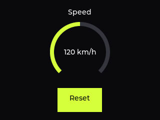

# Quick start

A speedometer for a 320 x 240 screen, in one short file. It shows the three ideas of lvgl26: a screen is a tree, a value is typed, and widgets follow a value.



You need no display and no board. The program draws into memory and writes a PNG file.

## The program

This is all of `main.cpp`, in three parts.

**A value.** `lv::state` holds a value that widgets follow. The speed has a unit, so `speed = 3 * m` does not compile.

<!-- snippet: examples/quick_start/main.cpp state -->
```cpp
constinit lv::state speed{0 * km / h};

void reset() { speed = 0 * km / h; }
```

**A screen.** It is a tree, written as one constant. Properties go in `()`, children in `[]`. `lv::bind(speed)` ties a property to the value.

<!-- snippet: examples/quick_start/main.cpp tree -->
```cpp
constexpr auto ui = lv::column({.flex_align = {"center", "center", "center"}, .size = {320 * px, 240 * px}})[
    lv::label({.text = "Speed"}),
    lv::arc({.range = {0, 240}, .size = {120 * px, 120 * px}, .value = lv::bind(speed)})[
        lv::label({.align = "center", .text = lv::bind(speed)})],
    lv::button({.on_clicked = &reset})[lv::label({.text = "Reset"})]];
```

**A main.** Two objects start LVGL and give it a display. The display takes a theme: Signal, which comes with lvgl26. `lv::mount` creates the widgets.

<!-- snippet: examples/quick_start/main.cpp main -->
```cpp
constinit lv::frame<320, 240> frame;  // the display's memory

int main() {
  lv::application app;                                // LVGL starts; it stops when app goes out of scope
  lv::display display{app, frame, lv::signal::dark};  // no panel; Signal is the look

  auto root = lv::mount<ui>(display.screen());  // creates the widgets, and owns them
  if (!root) return 1;

  speed = 120 * km / h;  // the dial and the text follow
  return lv::write_png(display.screen(), "quick_start.png") ? 0 : 2;
}
```

Above them go the includes and two `using` lines for the units. `<lv/all.hpp>` is the whole library; a program that wants a shorter build includes `<lv/lv.hpp>` and the headers of what it uses ([Which header](which-header.md)):

```cpp
#include <lv/all.hpp>
#include <lv/png.hpp>
#include <lv/signal.hpp>

#include <mp-units/systems/si.h>

using namespace lv::units;
using namespace mp_units::si::unit_symbols;
```

The whole file is [examples/quick_start/main.cpp](../examples/quick_start/main.cpp).

## Build and run

You need GCC 16, CMake 3.30 and Ninja. There are three ways to get them.

- **The template.** [lvgl26-template](https://github.com/filipsajdak/lvgl26-template) on GitHub holds this program, set up for a dev container and for CI. Use it as a template and open it in a dev container.
- **The image.** `ghcr.io/filipsajdak/lvgl26-toolchain:16` has GCC 16.2, CMake, Ninja, ccache and git, for amd64 and arm64: `docker run --rm -it -v "$PWD":/w -w /w ghcr.io/filipsajdak/lvgl26-toolchain:16 bash`.
- **macOS.** `brew install gcc cmake ninja`.

Put this `CMakeLists.txt` next to `main.cpp`:

<!-- snippet: examples/quick_start/CMakeLists.txt -->
```cmake
cmake_minimum_required(VERSION 3.30)
project(quick_start LANGUAGES C CXX)

include(FetchContent)
set(LVGL26_UNITS ON)  # lvgl26 brings mp-units, for values with a unit
FetchContent_Declare(lvgl26 GIT_REPOSITORY https://github.com/filipsajdak/lvgl26 GIT_TAG main)
FetchContent_MakeAvailable(lvgl26)

add_executable(quick_start main.cpp)
target_link_libraries(quick_start PRIVATE lvgl26::lvgl26)
```

`LVGL26_UNITS` makes lvgl26 fetch [mp-units](https://github.com/mpusz/mp-units), the library behind `120 * km / h`. Pin a commit of lvgl26 instead of `main` for a product.

Then:

```sh
cmake -B build -G Ninja -DCMAKE_C_COMPILER=gcc-16 -DCMAKE_CXX_COMPILER=g++-16
cmake --build build
cd build && ./quick_start
```

In the container, leave the two `-D` options out. The first build takes a minute or two, because it compiles LVGL. Then open `quick_start.png`.

## What you just used

| Idea | In the program | It gives you |
|---|---|---|
| The tree | `constexpr auto ui = lv::column(...)[...]` | The compiler reads the screen. A wrong property or a missing unit stops the build. |
| Typed values | `120 * km / h`, `320 * px` | A length is not a speed, and a number is not a length. |
| State and binding | `lv::state`, `lv::bind(speed)` | Change the value; the dial and the text follow. |
| Names, not C | `.align = "center"` | An LVGL value is its name in quotes. A wrong name lists the right ones. |
| A theme | `lv::signal::dark` | One look for every widget. The screen has no style in it. |
| Objects own things | `lv::application`, `lv::display`, `root` | Nothing to shut down or delete by hand. |

## Try a mistake

Give the title a width without a unit: `lv::label({.text = "Speed", .width = 120})`. The build stops and says what the property takes:

```text
error: static assertion failed: lv: wrong value for this property. It takes a width or x
(120 * lv::px, 50 * lv::pct or lv::size_content, not a vertical length). You gave int.
```

## If you come from another framework

| You know | In lvgl26 |
|---|---|
| A QML or Slint document | The `constexpr` tree. It is C++: no second language, no code generator |
| A property binding | `lv::bind(state)` |
| A signal handler or callback | `.on_clicked = &reset`, or a coroutine that waits for the event |
| `QApplication` and `exec()` | `lv::application` and `run()` |

## Where next

- [Themes](themes.md) shows Signal's other form, and how to make a theme of your own.
- The [README](../README.md) tours the rest: styles and design tokens, derived values, coroutines, animation.
- [examples](../examples/README.md) holds LVGL's own examples, rewritten with lvgl26.
- [Coming from Qt Quick](from-qt.md), [Slint](from-slint.md) and [TouchGFX](from-touchgfx.md) give the steps of a port and the decisions you must make.
- [Port walkthrough: the Slint printer panel](port-slint-printer.md) shows a whole application ported, with its pictures and code.
- [Port LVGL's own examples](port-lvgl-examples.md) shows how a port is compared with the C original, pixel for pixel.
