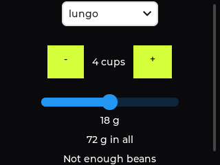

# State and bindings

A state holds a typed value of the application, and every widget, computed value and effect that follows it changes with it.

Header: `<lv/lv.hpp>`, the core.



## The smallest example

`lv::state` holds a value. `lv::bind` makes a property follow it: here the text of a label, through a format.

<!-- snippet: examples/state/main.cpp smallest -->
```cpp
constinit lv::state cups{lv::counter{2}};  // a value that widgets follow

constexpr auto cups_text = lv::label({.text = lv::bind(cups, "{} cups")});  // shows it, and follows it
```

Once the label is mounted, a new value is all the program writes. The label then shows "4 cups", and all else that follows `cups` changes with it.

<!-- snippet: examples/state/main.cpp change -->
```cpp
  cups = lv::counter{4};  // the count, the total, the warning and the grinder follow
```

## How it works

A state keeps its value and a list of what follows it: bound widgets, computed values and effects. The state itself takes no heap.

A new value tells each follower in turn. A value equal to the one the state has tells nobody, except a pointer, which cannot be compared.

A bound property is set when its widget is built, then after each change. Its follower is a small node on LVGL's heap, which goes with the widget.

An arc, a slider, a roller and a dropdown also write the user's change back into the state.

A state is usually a `constinit` global. It then holds its first value before `main` runs, and outlives every widget that follows it.

A state cannot be copied or moved, because its followers point at it. Like everything of LVGL, it is touched from the UI thread only.

## What you can do

### Hold a value that says what it is

A state holds a quantity with its unit, an `lv::counter`, a struct with one member, an enum, a bool, a color or a pointer. A plain integer does not say what it counts, so it is refused.

<!-- snippet: examples/state/main.cpp typed -->
```cpp
enum class drink { espresso, lungo, americano };  // a choice: an enum
struct strength {                                 // a value with a name: a struct of one member
  int value;
};

constinit lv::state chosen{drink::lungo};
constinit lv::state bold{strength{3}};
constinit lv::state beans{60 * g};  // a measure: a quantity with its unit
```

| The value is | Write |
|---|---|
| A measure | an mp-units quantity with an integer number: `60 * g` |
| A count | `lv::counter{2}` |
| An index, an id, a setting | a struct with one integer, bool or enum member |
| A choice | an enum |
| A switch | `bool` |
| A text | `const char*` |

A text binding without a format shows a quantity with its unit, such as "60 g". A count or a named value shows its number.

### Make widgets follow it

`lv::bind(state)` is the value of a property. A text property also takes a format, `lv::bind(state, "{} cups")`, with one `{}` for the number.

<!-- snippet: examples/state/main.cpp tree -->
```cpp
constexpr auto ui = lv::column({.flex_align = {"center", "center", "center"}, .size = {320 * px, 240 * px}})[
    lv::dropdown({.options = lv::options_of<drink>, .selected = lv::bind(chosen), .width = 140 * px}),
    stepper<cups>(cups_text),
    lv::slider({.range = {1, 5}, .value = lv::bind(bold), .width = 200 * px}),  // follows, and writes back
    lv::label({.text = lv::bind(dose)}),                   // a quantity shows its unit: "18 g"
    lv::label({.text = lv::bind(needed, "{} g in all")}),  // a format shows the number only
    lv::label({.hidden = lv::bind(enough), .text = "Not enough beans"})];
```

The dropdown lists the enumerators of `drink` and follows `chosen` both ways. The slider follows `bold` and writes the user's choice into it.

### Change it

A state takes `=`, `++`, `--`, `+=` and `-=`, as its value does. `update(f)` sets the result of a function of the current value, and `get()` reads it.

A handler that only changes a state is a lambda in the tree, as in the part below. A lambda in a constant tree captures nothing, so it names the state.

### Make a value from states

`lv::computed` is a value made by a function from states and from other computed values. It is bound like a state, and stores nothing of its own.

<!-- snippet: examples/state/main.cpp computed -->
```cpp
using grams = decltype(beans.get());

constexpr auto least_dose = 12 * g;  // the dose of the mildest cup
constexpr auto dose_step = 2 * g;    // what one step of strength adds

// Values made from states, and from each other. They store nothing; binding one makes it follow.
constinit lv::computed dose{[](strength s) { return least_dose + s.value * dose_step; }, bold};
constinit lv::computed needed{[](lv::counter c, grams d) { return c.value * d; }, cups, dose};
constinit lv::computed enough{[](grams n, grams b) { return n <= b; }, needed, beans};
```

The function takes the values of the dependencies in their order. Its result follows the rules of a state, so it cannot be a plain integer either.

`get()` calls the function each time. A computed that is bound follows its dependencies, and tells its own followers only when its result changes.

A computed can depend only on objects defined before it, so a cycle cannot be written.

### Act when a value changes

`lv::effect` runs a function after each change of its dependencies. It is for what lies outside the screen: a device, a file, a log.

<!-- snippet: examples/state/main.cpp effect -->
```cpp
grams grinder_dose{};  // what the grinder is set to: outside the screen

// An action that follows a value: it runs at start() and after every change of `needed`.
constinit lv::effect grinder{[](grams n) { grinder_dose = n; }, needed};
```

An effect does nothing until `start()`, which runs it at once. `reset()` stops it.

<!-- snippet: examples/state/main.cpp start -->
```cpp
  grinder.start();  // runs now, and after every change of `needed`
```

A value for the screen is a computed, not an effect that writes a second state: the computed cannot get out of step.

### Give a part its state

A part is a function that returns a piece of tree. It takes its state as a template argument, so that the lambdas of its buttons can name it.

<!-- snippet: examples/state/main.cpp part -->
```cpp
// A count between two buttons. The part names its state as a template argument: a handler in a
// constant tree captures nothing, so each lambda names the state itself.
template <auto& Count>
  requires lv::dependency<std::remove_cvref_t<decltype(Count)>>
constexpr auto stepper(lv::tree_node auto shown) {
  return lv::row({.flex_align = {"center", "center", "center"}, .size = {lv::size_content, lv::size_content}})[
      lv::button({.on_clicked = [] { --Count; }})[lv::label({.text = "-"})],
      shown,
      lv::button({.on_clicked = [] { ++Count; }})[lv::label({.text = "+"})]];
}
```

The tree above calls it as `stepper<cups>(cups_text)`. [Concepts for parts](concepts.md) says more about the concepts a part takes.

### Decide where a state lives

A state that one screen uses lives in the file of that screen, next to its tree. A state that several screens read lives in a header of its own, as an `inline constinit` global.

What does not follow a state: a value read with `get()` and kept in a variable. It is a copy of the value at that moment.

## What the compiler checks

A state of a plain integer is refused, and the message says what to write instead:

<!-- snippet: tests/fail/state_plain_int.cpp -->
```cpp
#include <lv/lv.hpp>
lv::state<int> speed;
```

<!-- message: state_plain_int -->
```text
error: static assertion failed: lv: a state of a plain integer does not say what the number is. If it is a measure, give it a unit with mp-units: `lv::state speed{0 * km / h};`. If it counts things, use lv::counter: `lv::state clicks{lv::counter{}};`. For anything else, name it: `struct tab_index { int value; };`. To allow plain integers, set rules.raw_integer_state in the settings.
```

A computed changes when it is bound, so it cannot be `constexpr`:

<!-- snippet: tests/fail/computed_constexpr.cpp -->
```cpp
#include <lv/lv.hpp>
constinit lv::state<bool> on{false};
// A computed is `constinit`, like a state.
constexpr lv::computed off{[](bool b) { return !b; }, on};
```

<!-- message: computed_constexpr -->
```text
error: constexpr message: lv: an lv::computed cannot be a constexpr variable: binding it writes to it. Write `constinit lv::computed`, as for a state.
```

The function of a computed takes the values in the order of the dependencies:

<!-- snippet: tests/fail/computed_wrong_arguments.cpp -->
```cpp
#include <lv/lv.hpp>
constinit lv::state clicks{lv::counter{}};
constinit lv::state<bool> on{false};
// The function takes the values in the order of the dependencies: counter, then bool.
constinit lv::computed both{[](bool b, const char* c) { return b && c != nullptr; }, clicks, on};
```

<!-- message: computed_wrong_arguments -->
```text
error: static assertion failed: lv: the function of an lv::computed takes the values of its dependencies, in their order: (lv::counter, bool). Take each by value or by const reference. It is called as const: a `mutable` lambda does not fit.
```

These mistakes stop the build too, each with a test of its own in `tests/fail/`:

- a state of a type it cannot hold, such as `double` (`state_bad_type`);
- a property bound to a state of a type it cannot take (`bind_wrong_type`, `bind_computed_wrong_type`), or one that takes several values (`bind_two_values`);
- a format on a property that is not a text (`bind_format_not_text`), or a format without exactly one `{}` (`bind_printf_format`);
- a computed that returns a plain integer (`computed_plain_int`), or a type no state holds (`computed_bad_result`);
- a dependency that is no state, or a temporary (`computed_not_a_state`, `computed_temporary`, `effect_not_a_state`);
- an effect whose function takes other values (`effect_wrong_arguments`).

## What it costs

| Cost | What we know | Where it comes from |
|---|---|---|
| Processor time | not measured yet | not measured yet |
| RAM | A state is its value and the head of its list of followers, in the global itself. A bound widget adds a node on LVGL's heap, freed with the widget; a computed and an effect keep their nodes inside themselves. | [props.hpp](https://github.com/filipsajdak/lvgl26/blob/main/include/lv/props.hpp) and [computed.hpp](https://github.com/filipsajdak/lvgl26/blob/main/include/lv/computed.hpp), from the code |
| ROM | not measured yet | not measured yet |
| Stack | not measured yet | not measured yet |
| Compile time | A binding costs almost nothing once a file has the widget: ten labels took 55.8 G instructions, and 56.0 G with each bound to a state. | [compile-diagnosis.md](https://github.com/filipsajdak/lvgl26/blob/main/docs/research/compile-diagnosis.md), measured 2026-11-19 |

## Rules

<!-- rules: no-boilerplate-2 no-boilerplate-3 checked-1 expressive-2 extendable-3 fast-run-1 fast-run-10 fast-run-11 fast-build-5 -->
- [`no-boilerplate-2`](rules.md#no-boilerplate-2): Make a property follow a state with `lv::bind`, instead of a handler that copies the value into the widget.
- [`no-boilerplate-3`](rules.md#no-boilerplate-3): Write a handler that only changes a state as a lambda in the tree: `.on_clicked = [] { ++cups; }`.
- [`checked-1`](rules.md#checked-1): Give every value a type that says what it is: a quantity, an `lv::counter`, or a struct of one member.
- [`expressive-2`](rules.md#expressive-2): Name a value made from states as an `lv::computed`, and bind it like a state: `.hidden = lv::bind(enough)`.
- [`extendable-3`](rules.md#extendable-3): Give a part its state as a template argument, `stepper<cups>(...)`, so that its handlers can name the state.
- [`fast-run-1`](rules.md#fast-run-1): Keep states, lists and mounted trees in `constinit` globals or in variables: lvgl26 takes no heap for them.
- [`fast-run-10`](rules.md#fast-run-10): Make a property follow a state through `lv::bind`; never poll a value in a timer or a loop to set the property.
- [`fast-run-11`](rules.md#fast-run-11): Change only what changed: set or bind the one property, and never mount a tree again to show a new value.
- [`fast-build-5`](rules.md#fast-build-5): Bind, name and style nodes freely: after its first use in a file, a binding, an id or a property costs little to compile.
<!-- rules: end -->

## Limits

- A quantity in a state has an integer number: `0 * km / h`, not `0.0 * km / h`.
- A style property, a position and a size do not follow a state; a `set` at run time changes them.
- A text binding shows one value. A text made of two values is not a binding.
- A format shows the number of a quantity without its unit, so the format writes the unit: `"{} g in all"`.
- Two changes are two changes: between `a = x;` and `b = y;`, a computed of both sees the new `a` and the old `b`.
- A state is changed from the UI thread only.

What is planned for state is on the [status page](https://filipsajdak.github.io/lvgl26/status.html).

## Names

`<lv/lv.hpp>` declares `lv::state`, `lv::bind`, `lv::computed`, `lv::effect`, `lv::dependency`, `lv::state_value` and `lv::counter`, as [headers.json](https://github.com/filipsajdak/lvgl26/blob/main/docs/reference/headers.json) lists them. Which properties a widget has, and what each takes, is in the reference data: [lvgl-v9.6.0.json](https://github.com/filipsajdak/lvgl26/blob/main/docs/reference/lvgl-v9.6.0.json).
