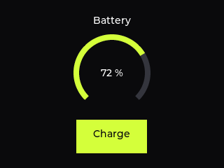

# Themes

A theme gives every widget of a kind its look, so a screen needs no styles of its own. Signal comes with lvgl26, and you make your own from a token file.

| Signal, dark | A theme of your own |
|---|---|
|  |  |

Both pictures show this screen. It has no style in it.

<!-- snippet: examples/theme/main.cpp tree -->
```cpp
constexpr auto ui = lv::column({.flex_align = {"center", "center", "center"}, .size = {320 * px, 240 * px}})[
    lv::label({.text = "Battery"}),
    lv::arc({.range = {0, 100}, .size = {110 * px, 110 * px}, .value = 72})[
        lv::label({.align = "center", .text = "72 %"})],
    lv::button[lv::label({.text = "Charge"})]];
```

## Use Signal

Signal is the design system of this project. Include it and give it to the display:

```cpp
#include <lv/signal.hpp>

lv::display display{app, frame, lv::signal::dark};
```

- `lv::signal::dark` is for indoor devices and OLED screens. `lv::signal::day` is for screens read in sunlight.
- The theme covers the screen, boxes, buttons, arcs and bars. The other widgets keep LVGL's look.
- Signal's tokens are there for your own styles: `lv::signal::dark_tokens.color.muted`.

## Make your own

A theme is one constant. It has a member for each kind of widget, and each member holds the styles a node of a tree can have: `style`, `style_pressed`, `style_indicator` and the rest.

<!-- snippet: examples/theme/main.cpp paper -->
```cpp
constexpr char tokens_json[] = {
#embed "tokens.json"
    , 0};
constexpr auto tok = lv::tokens<tokens_json>;

constexpr auto paper = lv::theme({
    .arc = {.style = {.arc_color = tok.color.rule, .arc_width = tok.stroke.ring},
            .style_indicator = {.arc_color = tok.color.accent, .arc_width = tok.stroke.ring},
            .style_knob = {.bg_opa = tok.opacity.none}},
    .button = {.style = {.bg_color = tok.color.accent,
                         .pad_hor = tok.space.button_x,
                         .pad_ver = tok.space.button_y,
                         .radius = tok.radius.button,
                         .shadow_width = tok.space.none,
                         .text_color = tok.color.on_accent},
               .style_pressed = {.bg_color = tok.color.ink}},
    .obj = {.style = {.bg_opa = tok.opacity.none,
                      .border_width = tok.space.none,
                      .pad_all = tok.space.edge,
                      .pad_gap = tok.space.gap,
                      .text_color = tok.color.ink}},
    .screen = {.style = {.bg_color = tok.color.paper, .bg_opa = tok.opacity.opaque}},
});
```

The values are design tokens, as in every style. The token file of this example is [examples/theme/tokens.json](../examples/theme/tokens.json).

| Member | Styles |
|---|---|
| `screen` | A widget without a parent |
| `obj` | A plain box: `lv::box`, `lv::column`, `lv::row` |
| `arc`, `bar`, `button`, `label`, ... | The widget LVGL calls by that name |
| `toggle` | LVGL's switch: `switch` is a C++ keyword |

The members are in alphabetical order, as designated initializers need.

## Give it to a display

The theme is the last argument of a display. This function draws the screen with any theme:

<!-- snippet: examples/theme/main.cpp draw -->
```cpp
bool draw(lv::application& app, lv::theme_styles theme, const char* file) {
  lv::display display{app, frame, theme};
  auto root = lv::mount<ui>(display.screen());
  return root && lv::write_png(display.screen(), file);
}
```

<!-- snippet: examples/theme/main.cpp main -->
```cpp
int main() {
  lv::application app;
  if (!draw(app, lv::signal::dark, "theme_signal.png")) return 1;
  if (!draw(app, paper, "theme_paper.png")) return 2;
  return 0;
}
```

## What a theme costs

- **No heap.** The compiler works the theme out, and its styles are constants in read-only memory. LVGL keeps a pointer to each.
- **Compile time.** A file that makes a theme compiles about a second longer. `lv/signal.hpp` makes two themes: about two seconds. Include it in one file.

## Rules

- A theme is applied after LVGL's own theme. It only says what differs.
- A node still has the last word: its `.style` wins over the theme.
- A widget gets the styles of its own kind only. A slider does not get those of `bar`.
- A member styles one part or one state. A part in a state (the indicator of a checked switch) is not there yet.
- A display takes its theme when it is made. It cannot change it later.
