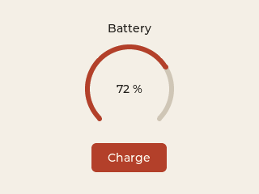
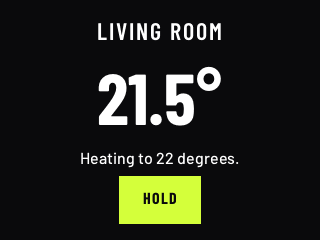

# Themes

A theme gives every widget of a kind its look, so a screen needs no styles of its own. Signal comes with lvgl26, and you make your own from a token file.

`lv::theme` is in its own header: `#include <lv/theme.hpp>`; Signal's themes are in `<lv/signal.hpp>` (see [Which header](which-header.md)).

| Signal, dark | A theme of your own |
|---|---|
|  |  |

Both pictures show this screen. It has no style in it.

<!-- snippet: examples/theme/main.cpp tree -->
```cpp
constexpr auto ui = lv::column(
  {.flex_align = {"center", "center", "center"}, .size = {320 * px, 240 * px}},
  lv::label({.text = "Battery"}),
  lv::arc(
    {
      .range = {0, 100},
      .size  = {110 * px, 110 * px},
      .value = 72,
    },
    lv::label({.align = "center", .text = "72 %"})
  ),
  lv::button(lv::label({.text = "Charge"}))
);
```

## Use Signal

Signal is the design system of this project. Include it and give it to the display:

```cpp
#include <lv/signal.hpp>

lv::display display{app, frame, lv::signal::dark};
```

- `lv::signal::dark` is for indoor devices and OLED screens. `lv::signal::day` is for screens read in sunlight.
- The theme covers the screen, boxes, buttons, arcs and bars. The other widgets keep LVGL's look.
- Signal's tokens are there for your own styles: `lv::signal::dark_tokens.color.muted`.

## Use Signal's typefaces

Signal sets numbers and titles in Barlow Condensed and everything else in Barlow. A second header makes these fonts, and two themes that use them.



```cpp
#include <lv/signal_type.hpp>

lv::display display{app, frame, lv::signal::dark_with_type};
```

- `lv::signal::dark_with_type` and `lv::signal::day_with_type` are `dark` and `day` with Signal's fonts.
- All text is `body`: Barlow at 16 px. The text of a button is `label`: Barlow Condensed at 16 px.
- Text is inherited. A label in a box takes the font of the screen, and a label in a button takes the font of the button.
- The two fonts are `lv::signal::body_font` and `lv::signal::label_font`, for a style of your own.
- The fonts have no glyph for LVGL's symbols. A widget that draws one, such as the arrow of a drop-down list, shows an empty box in its place.

The larger styles are yours to make, once each, in the file that shows them. `lv::signal::type` is Signal's typeface, and `lv::signal::type_tokens` is its typography.

<!-- snippet: examples/signal_type/main.cpp fonts -->
```cpp
// A copy: a reference to the tokens would keep the token file in the program.
constexpr auto text = lv::signal::type_tokens.text;

constexpr auto title = lv::signal::type(text.title);  // 24 px, the space to the tilde
constexpr auto reading =
  lv::signal::numerals(text.numeral_l);  // 72 px, the sixteen characters of a reading
```

<!-- snippet: examples/signal_type/main.cpp tree -->
```cpp
constexpr auto ui = lv::column(
  {
    .flex_align = {"center", "center", "center"},
    .size       = {320 * px, 240 * px},
    .style      = {.pad_gap = lv::signal::dark_tokens.space._2},
  },
  lv::label(
    {.text = "LIVING ROOM", .style = lv::style({.text_font = title}) | text.title}
  ),  // and its spacing
  lv::label({
    .text  = "21.5°",
    .style = {.text_font = reading},
  }),
  lv::label({.text = "Heating to 22 degrees."}), lv::button(lv::label({.text = "HOLD"}))
);
```

- `type` makes a font with the characters from the space to the tilde.
- `numerals` makes a font with sixteen characters: the digits, the point, the colon, the minus, the percent sign, the degree sign and the space. Signal keeps its large numbers in such a font.
- `numerals` holds Barlow Condensed at weight 700 only. A token of another style stops the build.

### Signal's fonts linked once

A program of several files draws no Signal font in any of them. Link the library and include the other header:

```cmake
set(LVGL26_SIGNAL_TYPE ON)           # before lvgl26 is added; the tests turn it on
target_link_libraries(app PRIVATE lvgl26::signal_type)
```

```cpp
#include <lv/signal_fonts.hpp>      // instead of <lv/signal_type.hpp>

lv::display display{app, frame, lv::signal::dark_with_type};
lv::label({.text = "21.5", .style = {.text_font = lv::font_of<"text.numeral-m", lv::signal::type_design>}})
```

- The names are those of `lv/signal_type.hpp`: `dark_with_type`, `day_with_type`, `body_font`, `label_font`, `type_tokens`. The fonts are the same glyphs, and the pictures are the same pixels. Include one of the two headers in a program, not both: the second stops the build and says so.
- The library draws the eight text styles of Signal, each in a file of its own (`lib/signal_type`). `title`, `label`, `body` and `caption` have the characters from the space to the tilde; the four `numeral-*` sizes have the sixteen of `numerals`. The linker takes only the fonts that the program names.
- A file that includes the header draws nothing: 78 G instructions instead of 250 G for the same screen. The library pays once, 108 G to 118 G for each font, side by side.
- `lv::signal::type` and `lv::signal::numerals` exist only in `lv/signal_type.hpp`, since they hold the font files.
- A font of the library is named with the design of Signal, `lv::font_of<"text.title", lv::signal::type_design>`. The build stops, before the link, when a file names one and the program links no library that draws it: `the font 'text.title' of the design lv::signal::type_design has no file that draws it. Link the library that draws it`.

### What the typefaces cost

Measured once on one machine, with `-Os` for the flash. The 208 px rows were measured again once the compiler drew fonts glyph by glyph. The compile time comes on top of `lv/signal.hpp`.

| Font | Characters | Compile time | In flash |
|---|---|---|---|
| `body` and `label`, 16 px: what the header makes | 95 each | about 7 s | 13 KB |
| `type` at `title`, 24 px | 95 | about 4 s | 11 KB |
| `numerals` at `numeral-m`, 40 px | 16 | under 1 s | 4 KB |
| `numerals` at `numeral-l`, 72 px | 16 | about 2 s | 11 KB |
| `numerals` at `numeral-xl`, 104 px | 16 | about 3 s | 20 KB |
| `numerals` at `numeral-2xl`, 208 px | 16 | about 6 s | 75 KB |
| `type` at `numeral-l`, 72 px | 95 | about 11 s | 62 KB |
| `type` at `numeral-xl`, 104 px | 95 | about 21 s | 123 KB |
| `type` at `numeral-2xl`, 208 px | 95 | about 34 s | 480 KB |

- This cost is why the fonts are not in `lv/signal.hpp`. Include `lv/signal_type.hpp` in one file, and make each larger font once.
- `title` and `label` are capitals with wide spacing. The themes space the text of a button; for a style of your own, merge the token: `lv::style({.text_font = title}) | text.title`.
- A numeral style with all 95 characters takes six times the flash of `numerals`. Use `type` for it only when the reading has letters.
- `numeral-2xl` is 208 px. `type` makes it too, but 95 characters of that size take 480 KB of flash and 5.4 GB of memory in the compiler. Use `numerals` for it.

### Tell-tale lamps

The law defines the colour of some tell-tale lamps: direction indicators and lights on are green, the main beam is blue.
Signal has a colour for each, in each theme, and they are in a header of their own:

```cpp
#include <lv/signal_lamps.hpp>

constexpr auto indicator = lv::signal::lamps.dark.green;  // lamps.day.green, lamps.dark.blue, lamps.day.blue
```

- A lamp colour is never a value, a state or a control. Normal has no colour in Signal.
- The colours are in `include/lv/signal/lamps.json`, written from the design file by `tools/signal_tokens.py`: every colour named `lamp-...` goes there, and not into the files of the themes.
- The header costs about 0.3 G instructions of compile time in the file that includes it. `lv/signal.hpp` and `lv/signal_type.hpp` do not include it, so a program without tell-tales pays nothing.

## Make your own

A theme is one constant. It has a member for each kind of widget, and each member holds the styles a node of a tree can have: `style`, `style_pressed`, `style_indicator` and the rest.

<!-- snippet: examples/theme/main.cpp paper -->
```cpp
constexpr char tokens_json[] = {
#embed "tokens.json"
  , 0
};
constexpr auto tok = lv::tokens<tokens_json>;

constexpr auto paper = lv::theme({
  .arc = {
    .style           = {.arc_color = tok.color.rule, .arc_width = tok.stroke.ring},
    .style_indicator = {.arc_color = tok.color.accent, .arc_width = tok.stroke.ring},
    .style_knob      = {.bg_opa = tok.opacity.none},
  },
  .button = {
    .style = {
      .bg_color     = tok.color.accent,
      .pad_hor      = tok.space.button_x,
      .pad_ver      = tok.space.button_y,
      .radius       = tok.radius.button,
      .shadow_width = tok.space.none,
      .text_color   = tok.color.on_accent,
    },
    .style_pressed = {.bg_color = tok.color.ink},
  },
  .obj = {
    .style = {
      .bg_opa       = tok.opacity.none,
      .border_width = tok.space.none,
      .pad_all      = tok.space.edge,
      .pad_gap      = tok.space.gap,
      .text_color   = tok.color.ink,
    },
  },
  .screen = {
    .style = {.bg_color = tok.color.paper, .bg_opa = tok.opacity.opaque},
  },
});
```

The values are design tokens, as in every style. The token file of this example is [examples/theme/tokens.json](../examples/theme/tokens.json).

| Member | Styles |
|---|---|
| `screen` | A widget without a parent |
| `obj` | A plain box: `lv::box`, `lv::column`, `lv::row` |
| `arc`, `bar`, `button`, `label`, ... | The widget LVGL calls by that name |
| `toggle` | LVGL's switch: `switch` is a C++ keyword |

The members are in alphabetical order, as designated initializers need.

## Style a part in a state

A member styles one part or one state: `style_knob` is the knob, `style_pressed` is the widget while pressed.
For a part in a state, such as the knob while pressed, put a selector into `style` with `lv::on`.

```cpp
constexpr auto mine = lv::theme({
    .slider = {.style = lv::style({.bg_color = tok.color.rule})
                        | lv::on("knob", "pressed", {.bg_color = tok.color.accent})
                        | lv::on("indicator", "checked", {.bg_color = tok.color.ink})},
});
```

- The first name is a part: `main`, `scrollbar`, `indicator`, `knob`, `selected`, `items`, `cursor`.
- The second name is a state: `default`, `checked`, `focused`, `pressed`, `disabled` and the others of LVGL.
- With one name, `lv::on` styles a part in the default state, or a state of the main part.
- A wrong name stops the build, and the message lists the right ones.
- A selector goes in `style` only. It names its own part, so `style_knob` cannot hold one.
- A node of a tree takes selectors the same way: `.style = base | lv::on("knob", "pressed", {...})`.

The compiler makes a constant style of each selector, as it does for the rest of the theme.
A selector costs no heap, and equal selectors share one style.

### Signal and selectors

Signal's themes are one description in `lv/signal.hpp`, the function `themed`.
A part in a state goes into its `style` members the same way, with Signal's tokens.
A ring with a knob that lights up while it is dragged would read:

```cpp
.arc = {.style = lv::style({.arc_color = Tok.color.line}) | lv::on("knob", "pressed", {.bg_color = Tok.color.active})},
```

Both Signal headers build their themes from that one description, so a selector added there reaches `dark`, `day` and the themes with fonts.

## Give it to a display

The theme is the last argument of a display. This function draws the screen with any theme:

<!-- snippet: examples/theme/main.cpp draw -->
```cpp
bool draw(lv::application& app, lv::theme_styles theme, const char* file) {
  lv::display display{app, frame, theme};
  auto root = lv::mount<ui>(display.screen());
  return root && lv::write_png(display.screen(), file);
}
```

<!-- snippet: examples/theme/main.cpp main -->
```cpp
int main() {
  lv::application app;
  if (!draw(app, lv::signal::dark, "theme_signal.png")) return 1;
  if (!draw(app, paper, "theme_paper.png")) return 2;
  return 0;
}
```

## What a theme costs

- **No heap.** The compiler works the theme out, and its styles are constants in read-only memory. LVGL keeps a pointer to each.
- **Compile time.** A file that makes a theme compiles about a second longer. `lv/signal.hpp` makes two themes: about two seconds. Include it in one file.

## Drop LVGL's own theme

LVGL builds its default theme when the first display is made. It takes 2532 bytes of heap on a Cortex-M4.
LVGL's simple and mono themes would take its place, so the option turns off all three.
A theme that sets every look you need makes them dead weight.
Turn it off in CMake, before lvgl26 is added: `set(LVGL26_NO_DEFAULT_THEME ON)`.
A widget then has only the look your theme gives it, and a display without a theme shows LVGL's bare styles.
Check each widget you use: a kind that your theme leaves out looks plain.
The option is off by default.

## Rules

- A theme is applied after LVGL's own theme. It only says what differs. Without LVGL's theme (see above) it is the whole look.
- A node still has the last word: its `.style` wins over the theme for the same part and state.
- A style for a state wins over one for the default state, wherever it comes from. A theme's `lv::on("knob", "pressed", ...)` beats a node's `.style_knob` while the knob is pressed. This is how LVGL picks a style.
- A shorthand (`pad_all`, `pad_hor`, `margin_ver`, `size`) is held as the properties it stands for. One rule decides when a style says a property twice, in a theme, in `lv::on`, in a node's `.style` and in a look alike: a long form (`pad_left`) beats a shorthand that covers it, and a narrower shorthand (`pad_hor`) beats a wider one (`pad_all`), in whatever order they are written.
- A widget gets the styles of its own kind only. A slider does not get those of `bar`.
- A member styles one part or one state. A part in a state is a selector in `style`: see above.
- A display takes its theme when it is made. It cannot change it later.
