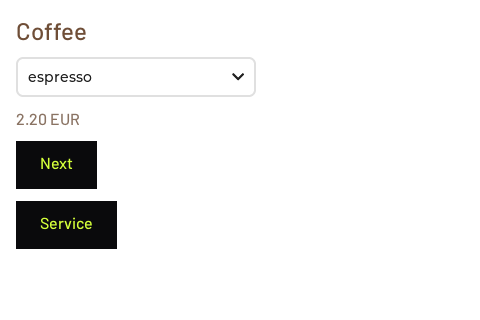
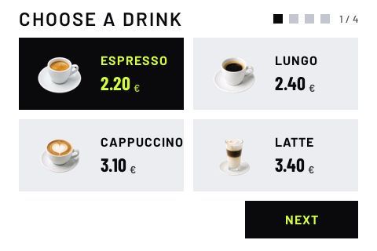
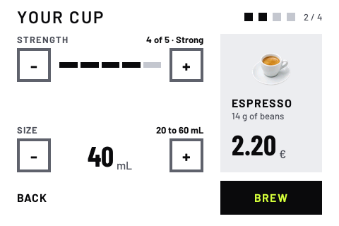
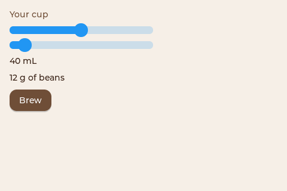
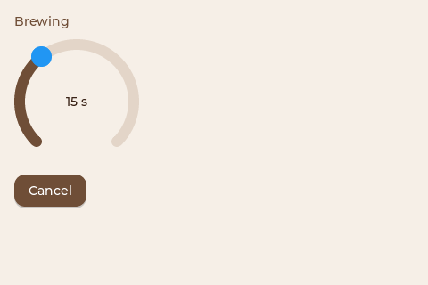
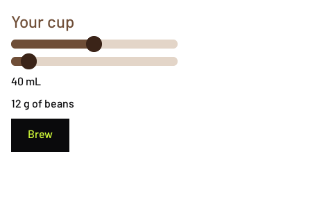
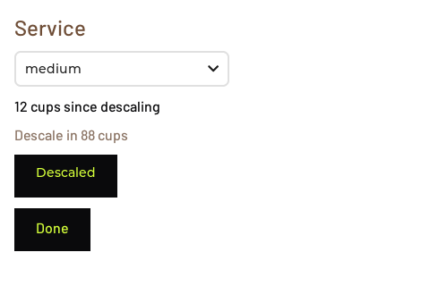

# Build a coffee machine in seven steps

This tutorial builds the screen of a coffee machine, 480 x 320, in seven programs. Each step adds one idea, and the page shows only what changed.



Each step is a whole program in [`examples/coffee/`](https://github.com/filipsajdak/lvgl26/tree/main/examples/coffee). A test builds it, runs it without a window, and compares the picture it draws with the one on this page.

| Step | Folder | What it adds |
|---|---|---|
| 1 | `1-screen` | A screen of photo tiles as one tree, a state, and looks and fonts from your own token file |
| 2 | `2-values` | Values that say what they are, set with steppers |
| 3 | `3-pages` | A page per step, which slides in |
| 4 | `4-time` | A task that brews, with a ring that fills |
| 5 | `5-design` | A design system you can reuse, and fonts of your own |
| 6 | `6-files` | The same program, split into files by screen |
| 7 | `7-service` | A service page, and the program's settings |

## 1. A screen

The reader chooses a drink from four tiles. From this first step the screen has the layout of the mock-up in [`design/coffee`](https://github.com/filipsajdak/lvgl26/tree/main/design/coffee). The title is top left and the step top right; below come the content, and a footer with the button that goes on.

The drink is a state of an enum. For each drink, `lv::computed` makes a value from the state, whether it is the chosen one, and stores nothing.

<!-- snippet: examples/coffee/1-screen/main.cpp state -->
```cpp
// What the reader chooses.
enum class drink { espresso, lungo, cappuccino, latte };

constinit lv::state chosen{drink::espresso};

// For each drink, whether it is the chosen one: a value made from the state.
template <drink D>
constinit lv::computed picked{[](drink d) { return d == D; }, chosen};
```

The photos are PNG files, cut out, that the compiler decodes into the pixels the display draws. Tables in the order of the enum hold what a tile shows of each drink.

<!-- snippet: examples/coffee/1-screen/main.cpp photos -->
```cpp
// A photo of each drink, cut out, at 1.5 x target: the compiler decodes it.
constexpr unsigned char espresso_png[] = {
#embed "../assets/espresso-72.png"
};
constexpr unsigned char lungo_png[] = {
#embed "../assets/lungo-72.png"
};
constexpr unsigned char cappuccino_png[] = {
#embed "../assets/cappuccino-72.png"
};
constexpr unsigned char latte_png[] = {
#embed "../assets/latte-72.png"
};

// What a tile shows of each drink, in the order of the enum.
constexpr decltype(lv::image_file<espresso_png>) photos[] = {
  lv::image_file<espresso_png>,
  lv::image_file<lungo_png>,
  lv::image_file<cappuccino_png>,
  lv::image_file<latte_png>,
};
constexpr const char* names[]  = {"ESPRESSO", "LUNGO", "CAPPUCCINO", "LATTE"};
constexpr const char* prices[] = {"2.20", "2.40", "3.10", "3.40"};
```

A tile is a part: a function that returns a piece of tree, one for each drink. It is checked while its drink is the chosen one, and a click chooses it. The screen is the header, the tiles and the footer.

<!-- snippet: examples/coffee/1-screen/main.cpp drinks -->
```cpp
// A tile: the photo, the name and the price. It is checked while its drink is the chosen one.
template <drink D>
constexpr auto tile() {
  return lv::button(
    {
      .checked    = lv::bind(picked<D>),
      .style      = lv::look<"tile">,
      .on_clicked = [] { chosen = D; },
    },
    lv::image({.src = photos[std::to_underlying(D)]}),
    lv::group(
      {.size = {lv::size_content, lv::size_content}, .style = lv::look<"tile-text">},
      lv::label({.text = names[std::to_underlying(D)], .style = label_text}),
      lv::group(
        {.size = {lv::size_content, lv::size_content}, .style = lv::look<"price-row">},
        lv::label({.text = prices[std::to_underlying(D)], .style = price_text}),
        lv::label({.text = "EUR", .style = lv::look<"currency"> | caption_text})
      )
    )
  );
}

constexpr auto tiles = lv::group(
  {.id = "tiles", .style = lv::look<"tiles">},
  lv::group({.style = lv::look<"tile-row">}, tile<drink::espresso>(), tile<drink::lungo>()),
  lv::group({.style = lv::look<"tile-row">}, tile<drink::cappuccino>(), tile<drink::latte>())
);

constexpr auto ui = lv::group(
  {.style = lv::look<"page">}, header("CHOOSE A DRINK", 1, "1 / 4"), tiles,
  footer(no_back, primary("NEXT"))
);
```

The header and the footer are parts too, and every screen of the machine uses them.

<!-- snippet: examples/coffee/1-screen/main.cpp parts -->
```cpp
// The header: the title top left, and the step top right as dots and "n / 4".
constexpr auto dot(bool on) {
  return lv::group({.style = on ? lv::look<"dot dot-on"> : lv::look<"dot">});
}

constexpr auto header(const char* title, int step, const char* count) {
  return lv::group(
    {.id = "header", .style = lv::look<"header">},
    lv::label({.text = title, .style = lv::look<"title"> | title_text}),
    lv::group(
      {.size = {lv::size_content, lv::size_content}, .style = lv::look<"dots">},
      dot(step >= 1),
      dot(step >= 2),
      dot(step >= 3),
      dot(step >= 4),
      lv::label({.text = count, .style = lv::look<"step"> | caption_text})
    )
  );
}

// The footer: going back bottom left, going on bottom right.
constexpr auto primary(const char* text) {
  return lv::button({.style = lv::look<"primary">}, lv::label({.text = text, .style = label_text}));
}

// A screen with nothing to go back to keeps the place empty.
constexpr auto no_back = lv::group({.size = {lv::size_content, lv::size_content}});

constexpr auto footer(lv::tree_node auto back, lv::tree_node auto next) {
  return lv::group({.id = "footer", .style = lv::look<"footer">}, back, next);
}
```

A node names its look, and the token file says how it looks. The project names its token file once, as `lv::design<lv::override>`. The values come first: colours, spaces, sizes, and the layout as named tokens, so that the footer's height is a token whose description says `target + space-4`. Then each group is a look, its entries named for the style properties they set. A look's layer (`pressed`, `checked`) is a state of the widget.

<!-- snippet: examples/coffee/1-screen/tokens.json -->
```json
{
  "$schema": "https://www.designtokens.org/schemas/2025.10/format.json",
  "$description": "The design of step 1 of the coffee machine tutorial (docs/tutorial.md), after the mock-up in design/coffee: values first, then one group for each look. A look's entries are named for the style properties they set.",
  "color": {
    "$type": "color",
    "ground": {"$value": {"hex": "#ffffff", "colorSpace": "srgb", "components": [1, 1, 1]}},
    "surface": {"$value": {"hex": "#ecedf0", "colorSpace": "srgb", "components": [0.9255, 0.9294, 0.9412]}},
    "surface-raised": {"$value": {"hex": "#dcdee3", "colorSpace": "srgb", "components": [0.8627, 0.8706, 0.8902]}},
    "line": {"$value": {"hex": "#c4c7cf", "colorSpace": "srgb", "components": [0.7686, 0.7804, 0.8118]}},
    "line-strong": {"$value": {"hex": "#5f626c", "colorSpace": "srgb", "components": [0.3725, 0.3843, 0.4235]}},
    "reading": {"$value": {"hex": "#0a0a0c", "colorSpace": "srgb", "components": [0.0392, 0.0392, 0.0471]}},
    "muted": {"$value": {"hex": "#4a4d57", "colorSpace": "srgb", "components": [0.2902, 0.302, 0.3412]}},
    "active": {"$value": {"hex": "#0a0a0c", "colorSpace": "srgb", "components": [0.0392, 0.0392, 0.0471]}},
    "on-active": {"$value": {"hex": "#d4ff3a", "colorSpace": "srgb", "components": [0.8314, 1, 0.2275]}}
  },
  "space": {
    "$type": "dimension",
    "none": {"$value": {"value": 0, "unit": "px"}},
    "1": {"$value": {"value": 4, "unit": "px"}},
    "2": {"$value": {"value": 8, "unit": "px"}},
    "3": {"$value": {"value": 12, "unit": "px"}},
    "4": {"$value": {"value": 16, "unit": "px"}},
    "6": {"$value": {"value": 24, "unit": "px"}}
  },
  "size": {
    "$type": "dimension",
    "screen-width": {"$value": {"value": 480, "unit": "px"}, "$description": "The machine's screen, landscape."},
    "screen-height": {"$value": {"value": 320, "unit": "px"}},
    "target": {"$value": {"value": 48, "unit": "px"}, "$description": "The smallest touch target: every control is at least this in both directions."},
    "photo": {"$value": {"value": 72, "unit": "px"}, "$description": "The photo of a drink on its tile: 1.5 x target."},
    "button": {"$value": {"value": 144, "unit": "px"}, "$description": "The narrowest button with a word: 3 x target."}
  },
  "layout": {
    "$type": "dimension",
    "margin": {"$value": "{space.6}", "$description": "Left and right of every screen."},
    "gap": {"$value": "{space.3}", "$description": "Between blocks, and between the content and the footer."},
    "pad": {"$value": "{space.4}", "$description": "Inside a tile."},
    "dot": {"$value": "{space.3}", "$description": "A dot of the step: a square."},
    "header-height": {"$value": "{size.target}", "$description": "The header: target."},
    "footer-height": {"$value": {"value": 64, "unit": "px"}, "$description": "The footer: target + space-4."}
  },
  "font": {
    "$type": "fontFamily",
    "display": {"$value": "Barlow Condensed"},
    "text": {"$value": "Barlow"}
  },
  "text": {
    "$type": "typography",
    "title": {"$value": {"fontFamily": "{font.display}", "fontSize": {"value": 24, "unit": "px"}, "fontWeight": 600, "letterSpacing": {"value": 2, "unit": "px"}, "lineHeight": 1.1667}},
    "label": {"$value": {"fontFamily": "{font.display}", "fontSize": {"value": 16, "unit": "px"}, "fontWeight": 700, "letterSpacing": {"value": 1, "unit": "px"}, "lineHeight": 1.25}},
    "price": {"$value": {"fontFamily": "{font.display}", "fontSize": {"value": 24, "unit": "px"}, "fontWeight": 700, "letterSpacing": {"value": 0, "unit": "px"}, "lineHeight": 1.1667}},
    "caption": {"$value": {"fontFamily": "{font.text}", "fontSize": {"value": 13, "unit": "px"}, "fontWeight": 500, "letterSpacing": {"value": 0, "unit": "px"}, "lineHeight": 1.3846}}
  },
  "page": {
    "bg_color": {"$value": "{color.ground}"},
    "bg_opa": {"$type": "number", "$value": 1},
    "pad_left": {"$value": "{layout.margin}"},
    "pad_right": {"$value": "{layout.margin}"},
    "text_color": {"$value": "{color.reading}"},
    "$extensions": {
      "io.github.filipsajdak.lvgl26": {
        "layout": "flex",
        "flex_flow": "column"
      }
    }
  },
  "header": {
    "height": {"$value": "{layout.header-height}"},
    "pad_column": {"$value": "{layout.gap}"},
    "$extensions": {
      "io.github.filipsajdak.lvgl26": {
        "layout": "flex",
        "flex_flow": "row",
        "flex_cross_place": "center"
      }
    }
  },
  "title": {
    "flex_grow": {"$type": "number", "$value": 1}
  },
  "dots": {
    "pad_column": {"$value": "{space.2}"},
    "$extensions": {
      "io.github.filipsajdak.lvgl26": {
        "layout": "flex",
        "flex_flow": "row",
        "flex_cross_place": "center"
      }
    }
  },
  "dot": {
    "width": {"$value": "{layout.dot}"},
    "height": {"$value": "{layout.dot}"},
    "bg_color": {"$value": "{color.line}"},
    "bg_opa": {"$type": "number", "$value": 1}
  },
  "dot-on": {
    "bg_color": {"$value": "{color.active}"}
  },
  "step": {
    "pad_left": {"$value": "{space.1}"},
    "text_color": {"$value": "{color.muted}"}
  },
  "tiles": {
    "flex_grow": {"$type": "number", "$value": 1},
    "pad_row": {"$value": "{layout.gap}"},
    "pad_bottom": {"$value": "{layout.gap}"},
    "$extensions": {
      "io.github.filipsajdak.lvgl26": {
        "layout": "flex",
        "flex_flow": "column"
      }
    }
  },
  "tile-row": {
    "flex_grow": {"$type": "number", "$value": 1},
    "pad_column": {"$value": "{layout.gap}"},
    "$extensions": {
      "io.github.filipsajdak.lvgl26": {
        "layout": "flex",
        "flex_flow": "row"
      }
    }
  },
  "tile": {
    "flex_grow": {"$type": "number", "$value": 1},
    "bg_color": {"$value": "{color.surface}"},
    "bg_opa": {"$type": "number", "$value": 1},
    "radius": {"$value": "{space.none}"},
    "shadow_width": {"$value": "{space.none}"},
    "pad_left": {"$value": "{layout.pad}"},
    "pad_right": {"$value": "{layout.pad}"},
    "pad_top": {"$value": "{space.none}"},
    "pad_bottom": {"$value": "{space.none}"},
    "pad_column": {"$value": "{layout.pad}"},
    "text_color": {"$value": "{color.reading}"},
    "pressed": {
      "bg_color": {"$value": "{color.surface-raised}"},
      "color_filter_opa": {"$type": "number", "$value": 0}
    },
    "checked": {
      "bg_color": {"$value": "{color.active}"},
      "text_color": {"$value": "{color.on-active}"}
    },
    "$extensions": {
      "io.github.filipsajdak.lvgl26": {
        "layout": "flex",
        "flex_flow": "row",
        "flex_cross_place": "center",
        "height": "100%"
      }
    }
  },
  "tile-text": {
    "pad_row": {"$value": "{space.1}"},
    "$extensions": {
      "io.github.filipsajdak.lvgl26": {
        "layout": "flex",
        "flex_flow": "column"
      }
    }
  },
  "price-row": {
    "$extensions": {
      "io.github.filipsajdak.lvgl26": {
        "layout": "flex",
        "flex_flow": "row",
        "flex_cross_place": "end"
      }
    }
  },
  "currency": {
    "pad_left": {"$value": "{space.1}"}
  },
  "footer": {
    "height": {"$value": "{layout.footer-height}"},
    "$extensions": {
      "io.github.filipsajdak.lvgl26": {
        "layout": "flex",
        "flex_flow": "row",
        "flex_main_place": "space_between",
        "flex_cross_place": "start"
      }
    }
  },
  "primary": {
    "height": {"$value": "{size.target}"},
    "min_width": {"$value": "{size.button}"},
    "pad_left": {"$value": "{space.6}"},
    "pad_right": {"$value": "{space.6}"},
    "bg_color": {"$value": "{color.active}"},
    "bg_opa": {"$type": "number", "$value": 1},
    "radius": {"$value": "{space.none}"},
    "shadow_width": {"$value": "{space.none}"},
    "text_color": {"$value": "{color.on-active}"},
    "pressed": {
      "bg_color": {"$value": "{color.surface-raised}"},
      "text_color": {"$value": "{color.reading}"},
      "color_filter_opa": {"$type": "number", "$value": 0}
    },
    "$extensions": {
      "io.github.filipsajdak.lvgl26": {
        "layout": "flex",
        "flex_main_place": "center",
        "flex_cross_place": "center"
      }
    }
  }
}
```

The text is set in the machine's own typeface, Barlow, from the typography tokens. The compiler draws each font from its file; a font is a style to merge with a look.

<!-- snippet: examples/coffee/1-screen/main.cpp fonts -->
```cpp
// The machine's own typeface, drawn from its files by the compiler, and the fonts of the
// typography tokens as styles to merge.
constexpr unsigned char barlow_ttf[] = {
#embed "fonts/Barlow-Medium.ttf"
};
constexpr unsigned char condensed_semibold_ttf[] = {
#embed "fonts/BarlowCondensed-SemiBold.ttf"
};
constexpr unsigned char condensed_bold_ttf[] = {
#embed "fonts/BarlowCondensed-Bold.ttf"
};
constexpr auto type = lv::typeface({
  {"Barlow", 500, barlow_ttf},
  {"Barlow Condensed", 600, condensed_semibold_ttf},
  {"Barlow Condensed", 700, condensed_bold_ttf},
});

constexpr auto title_text   = lv::style({.text_font = type(tok.text.title)}) | tok.text.title;
constexpr auto label_text   = lv::style({.text_font = type(tok.text.label)}) | tok.text.label;
constexpr auto price_text   = lv::style({.text_font = type(tok.text.price)});
constexpr auto caption_text = lv::style({.text_font = type(tok.text.caption)});
```

The program checks the screen it drew against the token file. The header is `target` high, the footer `target + space-4`, and the content between them the rest of the screen. A size that does not follow the design ends the program with a code of its own.

<!-- snippet: examples/coffee/1-screen/main.cpp geometry -->
```cpp
// The screen keeps the sizes of the design: each is a token, or a formula of tokens. The header
// is target high, the footer target + space-4, and the content between them the rest. A size
// that does not follow the design is an exit code of its own.
int geometry(lv::obj screen, lv::mounted<ui>& root) {
  const auto width = tok.size.screen_width->raw(), height = tok.size.screen_height->raw();
  const auto header = tok.size.target->raw(), footer = header + tok.space._4->raw();
  if (screen.get<"width">() != width || screen.get<"height">() != height) return 8;
  if (root->get<"header">().get<"height">() != header) return 4;
  if (root->get<"footer">().get<"height">() != footer) return 5;
  if (root->get<"tiles">().get<"height">() != height - header - footer) return 6;
  return 0;
}
```



See [The tree and its widgets](tree.md), [State and bindings](state.md), [Images](images.md), [Looks](looks.md) and [Fonts](fonts.md).

## 2. Values that say what they are

The second screen sets the cup: its strength and its size. A plain `int` would say neither. So the strength is a struct of one member, and the size is an mp-units quantity in millilitres, within what the drink can be made in. The beans, in grams, are made from the strength.

<!-- snippet: examples/coffee/2-values/main.cpp values -->
```cpp
// The strength of a cup, from 1 to 5: a struct of one member says what the number is.
struct strength {
  int value;
};

constexpr strength mildest{1};
constexpr strength strongest{5};

// The size, a quantity in millilitres, within what the drink can be made in.
constexpr auto ml = mp_units::si::milli<mp_units::si::litre>;
using millilitres = decltype(40 * ml);

struct cup_sizes {
  millilitres least, usual, most;
};
constexpr cup_sizes sizes[] = {
  {20 * ml, 40 * ml, 60 * ml},
  {80 * ml, 110 * ml, 150 * ml},
  {140 * ml, 180 * ml, 240 * ml},
  {180 * ml, 240 * ml, 300 * ml},
};
constexpr auto size_step = 10 * ml;

constexpr cup_sizes sizes_of(drink d) { return sizes[std::to_underlying(d)]; }

constinit lv::state bold{strength{3}};
constinit lv::state cup{sizes_of(drink::espresso).usual};

// The beans, a quantity in grams, made from the strength.
constexpr auto least_dose = 6 * g;  // the beans of the mildest cup
constexpr auto dose_step  = 2 * g;  // what one step of strength adds

constinit lv::computed beans{[](strength s) { return least_dose + s.value * dose_step; }, bold};

// The steppers: what each button does, and when it can go no further.
void milder() { bold = strength{std::max(mildest.value, bold.get().value - 1)}; }
void stronger() { bold = strength{std::min(strongest.value, bold.get().value + 1)}; }
void smaller() { cup = std::max(sizes_of(chosen.get()).least, cup.get() - size_step); }
void larger() { cup = std::min(sizes_of(chosen.get()).most, cup.get() + size_step); }

constinit lv::computed at_mildest{[](strength s) { return s.value <= mildest.value; }, bold};
constinit lv::computed at_strongest{[](strength s) { return s.value >= strongest.value; }, bold};
constinit lv::computed at_smallest{
  [](drink d, millilitres c) { return c <= sizes_of(d).least; }, chosen, cup
};
constinit lv::computed at_largest{
  [](drink d, millilitres c) { return c >= sizes_of(d).most; }, chosen, cup
};
```

A state of a plain integer does not compile:

<!-- message: state_plain_int -->
```text
error: static assertion failed: lv: a state of a plain integer does not say what the number is. If it is a measure, give it a unit with mp-units: `lv::state speed{0 * km / h};`. If it counts things, use lv::counter: `lv::state clicks{lv::counter{}};`. For anything else, name it: `struct tab_index { int value; };`. To allow plain integers, set rules.raw_integer_state in the settings.
```

The summary shows the chosen drink. Its photo, name and price are values made from the state, read from tables in the order of the enum. A photo is a pointer, which a state may hold, so the summary's image follows the drink.

<!-- snippet: examples/coffee/2-values/main.cpp photos -->
```cpp
// A photo of each drink, cut out, at 1.5 x target: the compiler decodes it.
constexpr unsigned char espresso_png[] = {
#embed "../assets/espresso-72.png"
};
constexpr unsigned char lungo_png[] = {
#embed "../assets/lungo-72.png"
};
constexpr unsigned char cappuccino_png[] = {
#embed "../assets/cappuccino-72.png"
};
constexpr unsigned char latte_png[] = {
#embed "../assets/latte-72.png"
};

// What a tile shows of each drink, in the order of the enum.
constexpr decltype(lv::image_file<espresso_png>) photos[] = {
  lv::image_file<espresso_png>,
  lv::image_file<lungo_png>,
  lv::image_file<cappuccino_png>,
  lv::image_file<latte_png>,
};
constexpr const char* names[]  = {"ESPRESSO", "LUNGO", "CAPPUCCINO", "LATTE"};
constexpr const char* prices[] = {"2.20", "2.40", "3.10", "3.40"};

// The chosen drink's photo, name and price, for the summary.
constinit lv::computed photo{[](drink d) { return photos[std::to_underlying(d)]; }, chosen};
constinit lv::computed name{[](drink d) { return names[std::to_underlying(d)]; }, chosen};
constinit lv::computed price{[](drink d) { return prices[std::to_underlying(d)]; }, chosen};

// What the fields say of the values.
constexpr std::array strength_words{
  "1 of 5, Mild", "2 of 5, Light", "3 of 5, Medium", "4 of 5, Strong", "5 of 5, Intense"
};
constexpr const char* size_ranges[] = {
  "20 to 60 mL", "80 to 150 mL", "140 to 240 mL", "180 to 300 mL"
};

constinit lv::computed strength_word{
  [](strength s) { return strength_words[static_cast<std::size_t>(s.value - mildest.value)]; }, bold
};
constinit lv::computed size_range{
  [](drink d) { return size_ranges[std::to_underlying(d)]; }, chosen
};
```

A stepper is a part: -, what is set, and +. Each button is disabled while its value can go no further. A field puts its name and what it says over the stepper; the strength shows as five segments, each checked up to the strength.

<!-- snippet: examples/coffee/2-values/main.cpp cup -->
```cpp
// A stepper: -, what is set, +. A button that can go no further is disabled.
constexpr auto stepper(
  const lv::dependency auto& at_least, const lv::dependency auto& at_most,
  lv::tree_handler auto less, lv::tree_handler auto more, lv::tree_node auto shown
) {
  return lv::group(
    {.style = lv::look<"stepper">},
    lv::button(
      {.disabled = lv::bind(at_least), .style = lv::look<"square">, .on_clicked = less},
      lv::label({.text = "-", .style = sign_text})
    ),
    shown,
    lv::button(
      {.disabled = lv::bind(at_most), .style = lv::look<"square">, .on_clicked = more},
      lv::label({.text = "+", .style = sign_text})
    )
  );
}

// A field: its name and what it says of its value, over its control.
constexpr auto field(
  const char* text, const lv::dependency auto& note, lv::tree_node auto control
) {
  return lv::group(
    {.size = {100 * pct, lv::size_content}, .style = lv::look<"field">},
    lv::group(
      {.size = {100 * pct, lv::size_content}, .style = lv::look<"field-top">},
      lv::label({.text = text, .style = lv::look<"overline"> | overline_text}),
      lv::label({.text = lv::bind(note), .style = caption_text})
    ),
    control
  );
}

// The strength as five segments: a segment is checked up to the strength.
template <int I>
constinit lv::computed segment_on{[](strength s) { return s.value >= I; }, bold};

template <int I>
constexpr auto segment() {
  return lv::group({.checked = lv::bind(segment_on<I>), .style = lv::look<"segment">});
}

constexpr auto segments = lv::group(
  {.style = lv::look<"segments">}, segment<1>(), segment<2>(), segment<3>(), segment<4>(),
  segment<5>()
);

constexpr auto size_value = lv::group(
  {.style = lv::look<"value">}, lv::label({.text = lv::bind(cup, "{}"), .style = numeral_text}),
  lv::label({.text = "mL", .style = lv::look<"unit"> | body_text})
);

constexpr auto fields = lv::group(
  {.style = lv::look<"fields">},
  field("STRENGTH", strength_word, stepper(at_mildest, at_strongest, &milder, &stronger, segments)),
  field("SIZE", size_range, stepper(at_smallest, at_largest, &smaller, &larger, size_value))
);

// The summary of the cup: the chosen drink's photo, name, beans and price.
constexpr auto summary = lv::group(
  {.id = "summary", .style = lv::look<"summary">},
  lv::group(
    {.size = {100 * pct, lv::size_content}, .style = lv::look<"photo-box">},
    lv::image({.id = "summary-photo", .src = lv::bind(photo)})
  ),
  lv::label({.text = lv::bind(name), .style = lv::look<"summary-name"> | label_text}),
  lv::label({.text = lv::bind(beans, "{} g of beans"), .style = lv::look<"beans"> | caption_text}),
  lv::group({.style = lv::look<"spacer">}),
  lv::group(
    {.size = {lv::size_content, lv::size_content}, .style = lv::look<"price-row">},
    lv::label({.text = lv::bind(price), .style = numeral_text}),
    lv::label({.text = "EUR", .style = lv::look<"unit"> | body_text})
  )
);

constexpr auto your_cup = lv::group(
  {.style = lv::look<"page">}, header("YOUR CUP", 2, "2 / 4"),
  lv::group({.style = lv::look<"cup">}, fields, summary), footer(back("BACK"), primary("BREW"))
);
```

A quantity bound with a format shows its number, and the label beside it says "mL". The program checks this screen against the token file too, and then a stronger cup: 14 g of beans, at 40 mL.



See [Values and units](values.md) and [State and bindings](state.md).

## 3. Pages

Each step of the machine gets a page of its own. The pages follow one state, `current`, and a button sets it.

<!-- snippet: examples/coffee/3-pages/main.cpp parts -->
```cpp
// A page's title, and a button that goes to another step.
constexpr auto title(const char* text) {
  return lv::label({.text = text, .style = lv::look<"title">});
}

template <step To>
constexpr auto go_to(const char* text) {
  return lv::button(
    {.style = lv::look<"action">, .on_clicked = [] { current = To; }}, lv::label({.text = text})
  );
}
```

`lv::shown` builds the page of the current step and deletes the old one. With a transition, the new page slides in while the old one slides out.

<!-- snippet: examples/coffee/3-pages/main.cpp pages -->
```cpp
// A page slides in from the right, and the old one slides out to the left.
constexpr auto slide_in  = lv::transition({.x = {480 * px, 0 * px}}, 250 * lv::ms, lv::ease::out);
constexpr auto slide_out = lv::transition({.x = {0 * px, -480 * px}}, 250 * lv::ms, lv::ease::in);

constexpr auto ui = lv::group(
  lv::shown(
    current, {.enter = slide_in, .leave = slide_out}, lv::is<step::drinks>(drinks),
    lv::is<step::cup>(your_cup), lv::is<step::brewing>(brewing), lv::is<step::enjoy>(enjoy)
  )
);
```



See [Mounting and slots](mounting.md).

## 4. Time

Brewing takes 25 seconds. A task counts them down and fills a ring, then goes to the last page. The brewing page starts it when it is built, with the ring as its owner, so Cancel ends it.

<!-- snippet: examples/coffee/4-time/main.cpp brewing -->
```cpp
constexpr auto brew_time = 25 * s;    // the time the machine brews, a value of the program
constexpr auto brew_span = 25 * sec;  // the same time, as LVGL counts it for the ring

constinit lv::state left{brew_time};

constexpr auto ring = lv::arc(
  {
    .id    = "ring",
    .range = {0, 100},
    .size  = {140 * px, 140 * px},
    .value = 0,
    .style = lv::look<"ring">,
  },
  lv::label({.align = "center", .text = lv::bind(left)})  // shows "25 s"
);

constexpr auto brewing =
  lv::group({.style = lv::look<"screen">}, title("Brewing"), ring, go_to<step::cup>("Cancel"));

// The ring fills while the seconds count down. Both end when the brewing page goes: Cancel
// deletes the ring, which owns them.
lv::task<> fill(lv::view<"arc"> view) {
  co_await lv::animate(view, {.value = {0, 100}}, brew_span, *tok.motion.brew);
}

lv::task<> brew(lv::view<"arc"> view) {
  lv::spawn(fill(view), view);
  for (left = brew_time; left.get() > 0 * s; left -= 1 * s) co_await lv::sleep(1 * sec);
  current = step::enjoy;
}

void start_brewing(lv::held<brewing> page) {
  const auto view = page->get<"ring">();
  lv::spawn(brew(view), view);
}
```

The arm of the brewing page names the hook: `lv::is<step::brewing>(brewing, {.on_shown = &start_brewing})`. The ring eases in and out with a token of the token file, `motion.brew`, a cubic Bézier curve.



See [Tasks](tasks.md) and [Animation](animation.md).

## 5. A design system you can reuse

Signal is the design system that comes with lvgl26, in `<lv/signal.hpp>`. Given to the display, it draws the screen, the buttons and the ring of the machine.

<!-- snippet: examples/coffee/5-design/main.cpp main -->
```cpp
int main() {
  lv::application app;
  lv::display display{app, coffee::frame, lv::signal::day};
  auto root = lv::mount<coffee::ui>(display.screen());
  if (!root) return 1;
```

The token file loses the looks that Signal covers. It keeps what is the machine's own: the layout and spacing of a page, the title, the price and the sliders, which Signal does not draw. A page is an `lv::group`, which takes no theme style, so its spacing stays in the look.

<!-- snippet: examples/coffee/5-design/tokens.json -->
```json
{
  "$schema": "https://www.designtokens.org/schemas/2025.10/format.json",
  "$description": "The design of step 5 of the coffee machine tutorial (docs/tutorial.md): Signal draws the screen, the buttons and the ring, so this file keeps only what is the machine's own. A look's entries are named for the style properties they set.",
  "color": {
    "$type": "color",
    "roast": {"$value": {"hex": "#3b2418", "colorSpace": "srgb", "components": [0.2314, 0.1412, 0.0941]}},
    "bean": {"$value": {"hex": "#6f4e37", "colorSpace": "srgb", "components": [0.4353, 0.3059, 0.2157]}},
    "muted": {"$value": {"hex": "#8a7363", "colorSpace": "srgb", "components": [0.5412, 0.451, 0.3882]}},
    "track": {"$value": {"hex": "#e3d5c8", "colorSpace": "srgb", "components": [0.8902, 0.8353, 0.7843]}}
  },
  "space": {
    "$type": "dimension",
    "page": {"$value": {"value": 16, "unit": "px"}},
    "gap": {"$value": {"value": 12, "unit": "px"}}
  },
  "font": {
    "text": {"$type": "fontFamily", "$value": "Barlow"}
  },
  "text": {
    "$type": "typography",
    "title": {"$value": {"fontFamily": "{font.text}", "fontSize": {"value": 24, "unit": "px"}, "fontWeight": 500, "letterSpacing": {"value": 0, "unit": "px"}, "lineHeight": 1.2}},
    "body": {"$value": {"fontFamily": "{font.text}", "fontSize": {"value": 16, "unit": "px"}, "fontWeight": 500, "letterSpacing": {"value": 0, "unit": "px"}, "lineHeight": 1.3}}
  },
  "motion": {
    "$type": "cubicBezier",
    "$description": "The ring fills slowly at first and at the end, as a cup does.",
    "brew": {"$value": [0.4, 0, 0.6, 1]}
  },
  "screen": {
    "pad_all": {"$value": "{space.page}"},
    "pad_row": {"$value": "{space.gap}"},
    "$extensions": {
      "io.github.filipsajdak.lvgl26": {
        "layout": "flex",
        "flex_flow": "column"
      }
    }
  },
  "title": {
    "text_color": {"$value": "{color.bean}"}
  },
  "price": {
    "text_color": {"$value": "{color.muted}"}
  },
  "slider": {
    "bg_color": {"$value": "{color.track}"},
    "bg_opa": {"$type": "number", "$value": 1},
    "indicator": {
      "bg_color": {"$value": "{color.bean}"}
    },
    "knob": {
      "bg_color": {"$value": "{color.roast}"}
    }
  }
}
```

The titles and the text are set in the machine's own typeface, the typography tokens `text.title` and `text.body` in Barlow. The program draws each font from the TrueType file, in the compiler. A font is a style of its own, merged with a look where a label has one.

<!-- snippet: examples/coffee/5-design/main.cpp font -->
```cpp
// The machine's own typeface, and the fonts of its titles and of its text, as styles to merge.
constexpr unsigned char barlow_ttf[] = {
#embed "fonts/Barlow-Medium.ttf"
};
constexpr auto type = lv::typeface({{"Barlow", 500, barlow_ttf}});

constexpr auto title_text = lv::style({.text_font = type(tok.text.title)});
constexpr auto body_text  = lv::style({.text_font = type(tok.text.body)});
```

<!-- snippet: examples/coffee/5-design/main.cpp parts -->
```cpp
// A page's title, and a button that goes to another step.
constexpr auto title(const char* text) {
  return lv::label({.text = text, .style = lv::look<"title"> | title_text});
}

template <step To>
constexpr auto go_to(const char* text) {
  return lv::button(
    {.on_clicked = [] { current = To; }}, lv::label({.text = text, .style = body_text})
  );
}
```

The drop-down list keeps LVGL's font. A drawn font has no glyph for LVGL's symbols, so the arrow of the list would show as a box.



See [Themes](themes.md) and [Fonts](fonts.md).

## 6. Split into files

The program of step 5 grows by screen, so it gets a file for each screen. Nothing else changes: the test of this step compares its picture with the picture of step 5.

```text
6-files/
  main.cpp                 starts the application and draws the pictures
  shell.cpp, shell.hpp     shows the page of the current step
  state.hpp                what several screens share
  screens/                 a file for each screen, with the states only it uses
  parts/                   functions that return a piece of tree
  design/                  the token file, the theme, the fonts and the files that draw them
  platform/window.cpp      the same program in a window, the only file that knows SDL
```

Each screen defines its page. Its header declares only the page, so a screen's tree is compiled in its own file and nowhere else.

<!-- snippet: examples/coffee/6-files/screens/drinks.cpp page -->
```cpp
constinit const lv::page drinks_page = lv::page_of<drinks>;
```

The shell names the pages as `lv::shown` named the trees in step 3. A page's hook is named with the page.

<!-- snippet: examples/coffee/6-files/shell.cpp pages -->
```cpp
// A page slides in from the right, and the old one slides out to the left.
constexpr auto slide_in  = lv::transition({.x = {width * px, 0 * px}}, 250 * lv::ms, lv::ease::out);
constexpr auto slide_out = lv::transition({.x = {0 * px, -width * px}}, 250 * lv::ms, lv::ease::in);

constexpr auto ui = lv::group(
  lv::shown(
    current, {.enter = slide_in, .leave = slide_out}, lv::is<step::drinks>(drinks_page),
    lv::is<step::cup>(cup_page), lv::is<step::brewing>(brewing_page),
    lv::is<step::enjoy>(enjoy_page)
  )
);
```

<!-- snippet: examples/coffee/6-files/screens/brewing.cpp page -->
```cpp
// The page's hook is named with the page, as an arm of lv::shown names it.
constinit const lv::page brewing_page = lv::page_of<brewing, {.on_shown = &start_brewing}>;
```

Each font is drawn in a file of its own, `design/font_text_title.cpp` and `design/font_text_body.cpp`. `design/fonts.hpp` names them with `lv::font_of`, so a file that includes it draws nothing. The build stops, before the link, when a file names a font that no file draws.

<!-- snippet: examples/coffee/6-files/design/fonts.hpp fonts -->
```cpp
inline constexpr auto title_text = lv::style({.text_font = lv::font_of<"text.title">});
inline constexpr auto body_text  = lv::style({.text_font = lv::font_of<"text.body">});
```

<!-- snippet: examples/coffee/6-files/design/font_text_title.cpp font -->
```cpp
namespace {

constexpr unsigned char barlow_ttf[] = {
#embed "fonts/Barlow-Medium.ttf"
};
constexpr auto type = lv::typeface({{"Barlow", 500, barlow_ttf}});

}  // namespace

template <>
const lv::drawn_font lv::font_object<"text.title"> = lv::draw<"text.title">(type);
```

- The shell cannot see the size of a page of another file. So the pages take one block of LVGL's heap when the shell is mounted, where step 5 keeps them in the tree.

See [Mounting and slots](mounting.md) and [Fonts](fonts.md).

## 7. A service page

One more screen, in a file of its own. It holds the hardness of the water and counts down the cups to the next descaling. The cups made are shared with brewing, so they live in `state.hpp`.

<!-- snippet: examples/coffee/7-service/screens/service.cpp service -->
```cpp
enum class hardness { soft, medium, hard };

constinit lv::state water{hardness::medium};

// Harder water scales the machine sooner: the cups between two descalings, in the order of the
// enum.
constexpr int cups_between[] = {200, 100, 50};

constinit lv::computed due{
  [](lv::counter made, hardness h) {
    return lv::counter{std::max(0, cups_between[std::to_underlying(h)] - made.value)};
  },
  cups,
  water
};
```

The machine's softener lies outside the screen. An `lv::effect` sets it whenever the hardness changes.

<!-- snippet: examples/coffee/7-service/screens/service.cpp effect -->
```cpp
hardness softener = hardness::medium;  // what the machine's softener is set to: outside the screen

// The softener follows the setting: once when the page is first shown, and after every change.
constinit lv::effect tell_softener{[](hardness h) { softener = h; }, water};
```

A program's settings are one file, `lvgl26.json`. The coffee machine's controller has no threads and no floating-point unit, so the file forbids both. A program that uses them stops at the line that does, with a message that names the setting.

<!-- snippet: examples/coffee/7-service/lvgl26.json -->
```json
{
  "$schema": "https://raw.githubusercontent.com/filipsajdak/lvgl26/main/docs/reference/lvgl26-settings.schema.json",
  "allow": {"threads": false, "floating_point": false}
}
```



See [Settings](settings.md) and [State and bindings](state.md).

## What comes next

- Run the machine in a window: build with `-DLVGL26_BUILD_WINDOW_EXAMPLES=ON` and start `coffee_7_window`.
- The drop-down lists keep LVGL's font until a drawn font can hold LVGL's symbols. The [status page](https://filipsajdak.github.io/lvgl26/status.html) lists that gap, with what else is planned.
