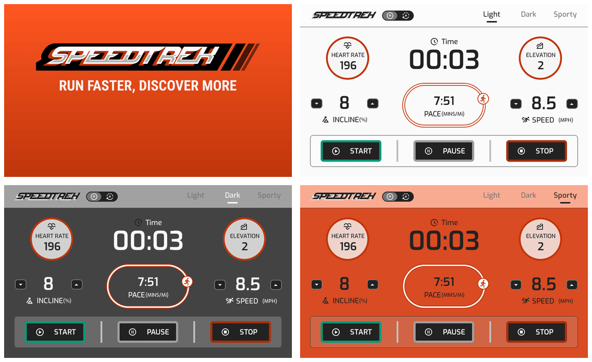

# Treadmill panel

A treadmill panel, ported from the `TreadmillMcuDemo` example of Qt Design Studio.
It has the same screens and behaviour as the original: the colors, the layout and the three looks follow it.
[NOTICE.md](NOTICE.md) says what is taken from the original and under which licence.



## Why this example

The example fits what lvgl26 expresses today: pictures, text, buttons, a few timed values and one slide animation.
The other Qt Design Studio examples that were read need more.
The washing machine lists its programs with a `ListView` over a `ListModel`, and the e-bike has a model list and a scrolling map.
The treadmill has no list, chart, shader or 3D.
It has no arc gauge either: its "gauge" is a dot on a track.

## What it shows

- A splash screen for five seconds. The slogan and the wordmark slide in over one second.
- The main screen with START, PAUSE and STOP. START counts a second at a time: a heart rate, the time, the pace for a mile and the elevation.
- Two arrows each for the incline (0 to 100 percent) and the speed (0 to 20 mph, in steps of 0.1).
- A dot that goes round the track once in ten seconds. PAUSE stops it and a second PAUSE goes on from there. STOP puts it back.
- A switch between manual and auto. In auto mode the incline and the speed walk up to the top and back, once a second.
- Three looks: Light, Dark and Sporty. A look changes the colors and two pictures. Readings and settings stay.

## Build and run

```sh
cmake --preset host-v96 && cmake --build --preset host-v96 --target treadmill_shot
build/host-v96/examples/ports/qt/treadmill/treadmill_shot <directory>   # one PNG for each scene
```

`treadmill_shot` needs no display. A window needs SDL2:

```sh
cmake --preset host-v96 -DLVGL26_BUILD_WINDOW_EXAMPLES=ON && cmake --build --preset host-v96 --target treadmill
```

The test `ports_treadmill` shows every scene and compares it with a reference picture in `tests/ref/`.
It also presses the buttons and runs the clocks.

## How it is built

Each page is its own source file with its own constant tree, mounted when the page is shown and deleted when it goes.
The compiler works on one page at a time, with the project's normal limit for constant evaluation.

| File | What it holds |
|---|---|
| `shell.cpp` | The window, the splash screen over the main screen, and the task that builds the screen again when the look changes |
| `splash_page.cpp` | The splash screen and its two slides |
| `main_page.hpp` | The main screen as one tree that takes a look's colors and two pictures |
| `main_light.cpp`, `main_dark.cpp`, `main_sporty.cpp` | One look each: the file instantiates the tree once and mounts it |
| `logic.cpp` | What the buttons do, the two one-second clocks, and the keyframes of the dot |
| `state.hpp` | The states: readings with units, flags, and the text of the readings |
| `parts.hpp` | Components: big button, arrow button, switch, look button, info panel, settings panel, track |
| `fonts.hpp`, `images.hpp`, `sizes.hpp`, `tokens.json` | Exo, the pictures, the places, and the design tokens |

- The speed is an mp-units quantity in tenths of a mile an hour, and the time is a quantity in seconds. The incline, the heart rate and the elevation are counts.
- A label that shows a time, a pace or a speed binds to a `lv::state<const char*>`. An `lv::effect` writes the text when the number changes.
- The three looks are three token groups with the same names (`tok.theme.light`, `dark`, `sporty`). The tree is a template on one group.
- A pressed button changes its rim and face through `style_pressed`, as the original shows its inner rectangle only while the button is up.
- The heart rate in the original is random. Here a generator with a fixed start gives the same numbers in every run, so the pictures do not change.
- Colors, sizes and fonts are tokens. The places of the original's boxes are named in `sizes.hpp`.

## What a file costs to compile

Measured once with GCC 16.2 on a heavily loaded machine, at the project's normal limit for constant evaluation.
The time is the processor time of the compiler (user and system). The memory is its peak.

| File | Time | Memory |
|---|---|---|
| `main_light.cpp` | 45 s | 1.3 GB |
| `main_dark.cpp` | 52 s | 1.0 GB |
| `main_sporty.cpp` | 43 s | 1.7 GB |
| `splash_page.cpp` | 30 s | 0.9 GB |
| `shell.cpp` | 17 s | 1.0 GB |
| `logic.cpp` | 18 s | 0.8 GB |

## What differs from the original

- The splash screen does not fade. The logos appear at their first place and slide.
  The screen ends at once after five seconds. lvgl26 cannot animate the opacity of a widget (see Findings in [examples/README.md](../../../README.md)).
- The Qt logo of the splash screen is left out, and the backdrop is a vertical gradient between the two colors of the original's picture. It has no lines in it. A whole-screen picture does not fit the 4 MB heap of the tests.
- A look is a new tree of the screen, built after the click. The original changes the colors of one tree in place. lvgl26 cannot bind a style to a state.
- The dot moves in steps of 20 ms. The original's timeline is continuous.
- The pace at a standstill shows 99:60, as in the original.
- The rings behind the readings, the lines and the two dividers are drawn from boxes. In the original they are one picture.
- The test compares each scene as a PNG file with a reference, not with LVGL's screenshot compare, which needs more heap than the tests have.
