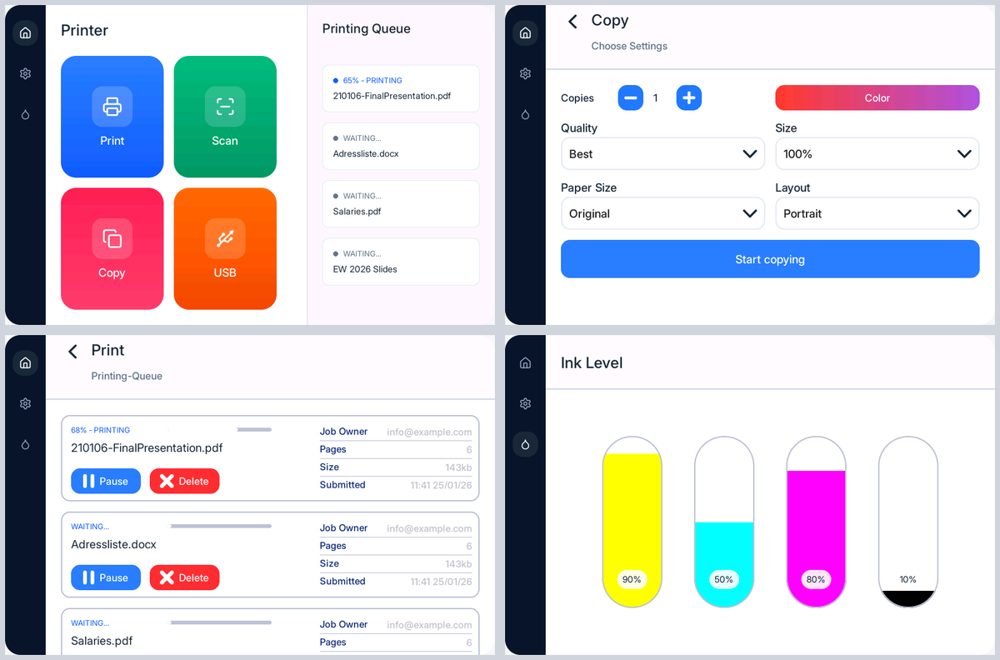

# Printer panel

A touch panel of a printer, ported from the printer demo of Slint.
It has the same screens and behaviour as the original: the colors, the layout and the page transitions follow it.
[NOTICE.md](NOTICE.md) says what is taken from the original and under which licence.
The page [Port walkthrough: the Slint printer panel](../../../../docs/port-slint-printer.md) explains how it is organised and why.



## What it shows

- A side bar that switches between three pages: home, settings and ink levels.
- The home page has four actions and the print queue. A tap on a job opens its details.
- Print, Scan, Copy and USB are sub-pages. Each slides in from the right over the home page and slides out on Back.
- The Print page lists the whole queue, with Pause and Delete for each job.
- Copy and Scan have a number of copies, a color or grayscale button, four choices and a start button. Start adds a job to the queue.
- The USB page shows a photo of the file you choose, and starts a print of it.
- The queue prints: once a second the first job gains a percent, and leaves at a hundred.
- The ink page fills four tubes to their levels, 30 ms after the page appears.

## Build and run

```sh
cmake --preset host-v96 && cmake --build --preset host-v96 --target printer_shot
build/host-v96/examples/ports/slint/printer/printer_shot <directory>   # one PNG for each page
```

`printer_shot` needs no display. A window needs SDL2:

```sh
cmake --preset host-v96 -DLVGL26_BUILD_WINDOW_EXAMPLES=ON && cmake --build --preset host-v96 --target printer
```

The test `ports_printer` shows every page and compares it with a reference picture in `tests/ref/`.

## How it is built

Each page is its own source file with its own constant tree, mounted when the page is shown and deleted when it goes.
The compiler works on one page at a time, with the project's normal limit for constant evaluation.

| File | What it holds |
|---|---|
| `shell.cpp` | The window, the side bar, and the `lv::shown` nodes that follow `active_page` and `active_subpage` |
| `home_page.cpp`, `settings_page.cpp`, `ink_page.cpp` | The three pages of the side bar |
| `print_page.cpp`, `copy.cpp`, `scan.cpp`, `usb_page.cpp` | The four sub-pages |
| `queue.cpp`, `queue_column.hpp` | The jobs, and the column of cards that the home page nests |
| `parts.hpp` | Components: icon button, spin box, choice, back header |
| `fonts.hpp`, `icons.hpp`, `tokens.json` | Inter, the pictures, and the design tokens |

- A page's file gives the shell one function, such as `mount_copy(lv::obj)`, and the shell owns what it returns.
- The state a page owns, such as the number of copies, lives in that page's file. It keeps its value while the page is away.
- Colors, sizes, durations and curves are tokens. The one exception is the arrow in `images/down.png`, whose color is in the picture.
- A font is made where it is used, so a page pays for the sizes it shows.

## What a file costs to compile

Measured on 2026-11-17 with GCC 16.2 and nothing else compiling, at the project's normal limit for constant evaluation.
The time is the processor time of the compiler. The memory is its peak.

| File | Time | Memory |
|---|---|---|
| `copy.cpp` | 19 s | 2.6 GB |
| `scan.cpp` | 19 s | 2.6 GB |
| `print_page.cpp` | 25 s | 3.4 GB |
| `usb_page.cpp` | 18 s | 2.6 GB |
| `home_page.cpp` | 28 s | 2.8 GB |
| `settings_page.cpp` | 19 s | 2.3 GB |
| `ink_page.cpp` | 15 s | 1.7 GB |
| `shell.cpp` | 11 s | 0.7 GB |
| `queue.cpp` | 3 s | 0.4 GB |

## What differs from the original

- The gradients are vertical or horizontal. The original's tiles run at 135 degrees, and its color button has four stops. lvgl26's styles take two colors and a direction.
- Only the Gradient theme is ported. The original has three more, switched from the side bar.
- The side bar has no theme menu, and the settings page has no translations. Pause does nothing, as in the original.
- Every sub-page slides. In the original source only the Print page animates its position.
- The ink tubes have no line at the surface of the ink.
